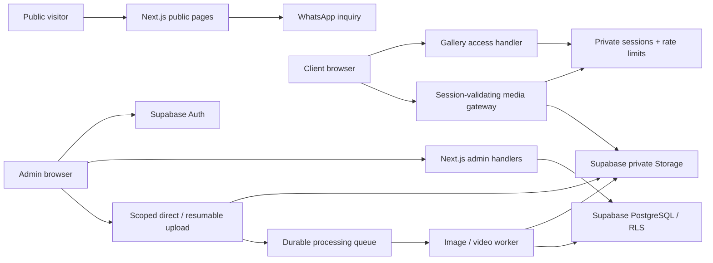
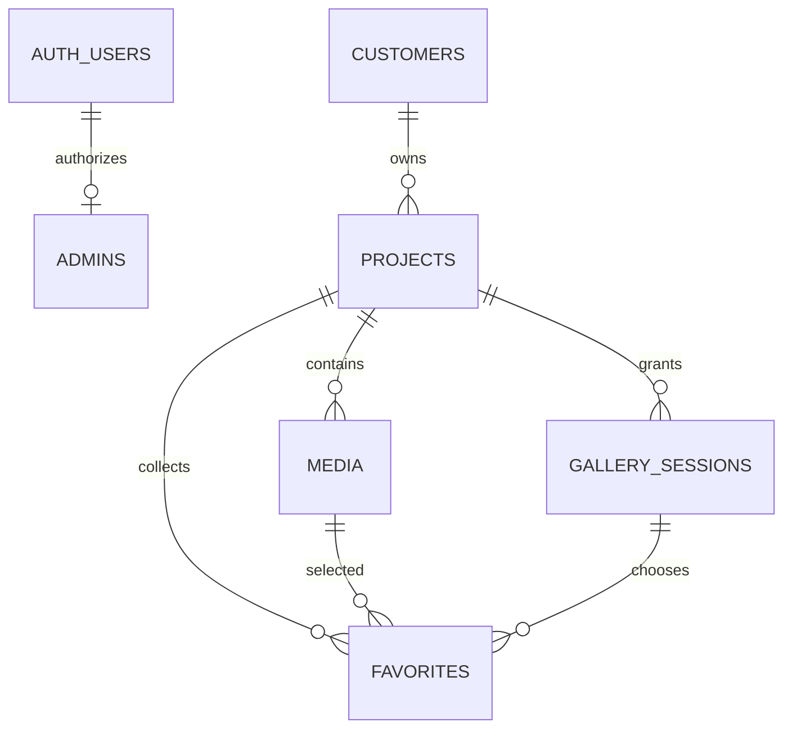

# Arsitektur teknis Elts.

## 1. Lingkup dan status

Fondasi aplikasi modular monolith pada Next.js. Public website dirender statis/server, interaksi kecil memakai Client Components. Database/auth memakai Supabase. Deployment target Vercel, version control target GitHub.

Dokumen ini membedakan kode **tersedia** dan desain **tahap berikutnya**. Endpoint yang direncanakan tidak dibuat sebagai mock yang menerima data atau mengembalikan autentikasi palsu.

| Modul                                              | Status saat ini                               |
| -------------------------------------------------- | --------------------------------------------- |
| Setup, design system, homepage, booking WhatsApp   | Tersedia                                      |
| Metadata, sitemap, robots, loading/error/not-found | Tersedia                                      |
| Schema, RLS, storage migrations                    | Tersedia; belum diterapkan ke hosted Supabase |
| Supabase clients, credential/access primitives     | Tersedia; diuji secara lokal                  |
| Admin Auth/proxy/dashboard/CRUD                    | Direncanakan, belum aktif                     |
| Client PIN login/session endpoints                 | Direncanakan, belum aktif                     |
| Private media delivery/upload/processor            | Direncanakan, belum aktif                     |
| Favorites dan lifecycle UI                         | Direncanakan; constraint database tersedia    |
| Analytics, ZIP, payment, invoice                   | Ditunda                                       |

## 2. Komponen sistem dan trust boundary



Browser tidak dipercaya untuk menentukan project yang dapat diakses. Project/session/media selalu dimuat ulang dari server. `access_token` pada path adalah locator acak 256 bit, bukan bukti otorisasi.

## 3. Keputusan storage

**Private client media: Supabase private Storage**, melalui contract `PrivateMediaStorage`. Public portfolio dapat memakai static optimized assets atau Cloudinary. Original customer tidak pernah masuk repository, `public/`, atau filesystem Vercel.

Alasan: Cloudinary `private` masih dapat menghasilkan derived asset yang publik. `authenticated` melindungi original/derived, tetapi signature URL biasa tidak otomatis kedaluwarsa. Token/cookie dengan expiry membutuhkan dukungan plan tertentu. Supabase private buckets sesuai kebutuhan awal dan menyederhanakan kontrol akses. Ini alternatif yang dipilih dari izin pengguna untuk menggunakan provider yang lebih sesuai. [Cloudinary access controls](https://cloudinary.com/documentation/control_access_to_media), [Supabase private delivery](https://supabase.com/docs/guides/storage/serving/downloads).

Untuk memenuhi aturan **setiap request media harus memeriksa sesi**, client menerima URL gateway same-origin seperti `/api/media/{id}/preview?variant=thumbnail`. Gateway memvalidasi sesi, project, status, expiration, ID media dan izin download, lalu men-stream bytes. Tidak mengirim redirect ke URL upstream atau menyimpan URL private pada HTML.

Signed URL adalah bearer credential yang masih dapat dipakai sampai habis masa berlakunya; tidak dianggap sebagai pengganti validasi sesi setiap request. Jika direct CDN delivery dipilih kelak, perubahan model ini harus dinyatakan eksplisit, memakai TTL sangat pendek dan menerima jendela revocation. Gateway video/original besar harus mendukung HTTP Range dan diuji terhadap durasi, bandwidth, concurrency, dan streaming limits deployment. Jika batas Vercel tidak sesuai, tempatkan gateway streaming pada runtime terpisah sebelum mengaktifkan video besar. Jangan buffer seluruh file. [Vercel function limits](https://vercel.com/docs/functions/limitations).

## 4. Struktur folder

Struktur yang **sudah ada**:

```text
src/
  app/
    (public)/
      layout.tsx
      page.tsx
      loading.tsx
    client/page.tsx             # informasi persiapan, bukan login palsu
    layout.tsx
    globals.css
    error.tsx
    not-found.tsx
    robots.ts
    sitemap.ts
    icon.svg
  components/
    ui/                        # primitives shadcn-style
    layout/                    # Navbar, Footer
    home/                      # Hero, AboutPreview, Services, BookingCta
    portfolio/                 # FeaturedWorks + public lightbox
    shared/                    # SectionTitle
  config/site.ts
  content/photography.ts        # data portfolio publik
  lib/
    env.ts                     # lazy server-only env validation
    utils.ts
    auth/admin.ts
    security/                  # PIN/session crypto, pure access policy
    supabase/                  # browser, SSR, service clients
  services/storage/contracts.ts
  types/                       # database + portfolio contracts
supabase/migrations/
tests/
docs/
scripts/
public/images/                 # hanya preview portfolio publik
.github/workflows/ci.yml
```

Tambahan berikut dibuat ketika fiturnya dikerjakan, bukan folder kosong:

```text
src/app/(public)/{portfolio,services,about,contact}/page.tsx
src/app/admin/(auth)/login/page.tsx
src/app/admin/(dashboard)/layout.tsx
src/app/admin/(dashboard)/{projects,customers,media,favorites,analytics,settings}/
src/app/gallery/[token]/page.tsx
src/app/api/{client,projects,customers,media}/...
src/proxy.ts
src/components/{admin,gallery,forms}/
src/services/{projects,customers,sessions,media,favorites}/
src/hooks/{use-upload-queue,use-gallery-favorites}.ts
workers/media-processor/        # separate job runtime, never request-time video processing
```

Route Handlers memvalidasi input dan mengotorisasi, service menjalankan business rule, repository/access layer mengakses DB. Jangan mengembalikan `ProjectRow` atau `MediaRow` mentah ke client: gunakan DTO allowlist tanpa hash, private keys, session token, atau provider credentials.

## 5. Database

Semua waktu memakai `timestamptz`; shoot date memakai `date`. Primary key UUID, FK/index untuk lookup, constraints untuk status/MIME/ukuran/prefix keys. Types SQL enum diselaraskan dengan TypeScript. Type sementara di `types/database.ts` harus diregenerasi dari database aktual setelah migrasi; schema DB adalah sumber kebenaran.



| Tabel                         | Fungsi dan keputusan                                                                                  |
| ----------------------------- | ----------------------------------------------------------------------------------------------------- |
| `public.admins`               | Membership berdasarkan `auth.users`; user biasa bahkan admin UI tidak dapat mengubah membership       |
| `public.customers`            | Identitas, kontak, archive timestamp                                                                  |
| `public.projects`             | Customer, nama, type, status, salted PIN hash, code, random locator, permissions, cover media, expiry |
| `public.media`                | MIME, ukuran, dimensi, original/preview keys, processing state, urutan; Cloudinary ID opsional        |
| `public.favorites`            | Unique `(session_id, media_id)`; FK gabungan menolak media/session dari project lain                  |
| `private.gallery_sessions`    | SHA-256 dari token acak, project, akses, expiry, revocation; tidak di-expose PostgREST                |
| `private.gallery_rate_limits` | Counter persisten atomic, expiry; key adalah HMAC, bukan raw IP atau code                             |

`cover_media_id` menggantikan permanent `cover_image` URL dan wajib menunjuk media project yang sama. Penghapusan cover men-null-kan cover reference. `original_key`, `thumbnail_key`, `preview_key` menggantikan kolom URL permanen. URL delivery dibuat melalui gateway; schema sengaja tidak menyimpan signed URL yang akan stale.

Status yang valid: `draft → editing → ready`, dengan `archived` untuk nonaktif dan `expired` untuk penanda administrasi. Akses selalu membandingkan `expires_at` real-time; tidak menunggu cron mengubah status. Active dashboard filter = ready + belum kedaluwarsa; Editing = editing; Archived = archived. Tidak menambahkan enum `completed` yang ambigu terhadap status brief.

Session yang expired/revoked **tidak dihapus** selama favorites mereferensikannya. Logout tidak menghapus pilihan. Untuk pilihan lintas perangkat/PIN login baru, tahap Favorites memerlukan identitas visitor yang stabil atau model project-wide selection dengan conflict semantics yang disepakati; jangan menyatukan session secara diam-diam. Admin dapat melihat gabungan pilihan semua sesi project.

## 6. RLS dan administrator

- Semua tabel RLS ON; anon tidak mendapat akses record bisnis atau object privat.
- User Supabase biasa tidak mendapat akses studio meskipun signup/login berhasil.
- `private.is_admin()` memakai `SECURITY DEFINER`, `search_path=''`, dan qualified references. Policy scope `authenticated` memeriksa membership actual, bukan `user_metadata`.
- Membership awal ditambahkan lewat SQL tepercaya setelah user Auth dibuat. Self-registration tidak menciptakan admin.
- `requireAdmin()` memverifikasi `getUser()` dan row admin. Service role tetap server-only, tidak untuk query admin yang bisa memakai user client + RLS.
- Pada tahap Admin, tambahkan `src/proxy.ts` (nomenklatur Next.js 16 pengganti middleware) untuk refresh cookies dan redirect. Proxy bukan satu-satunya security boundary: setiap handler/action mengulangi authorization. [Next.js authentication](https://nextjs.org/docs/app/guides/authentication), [Supabase SSR](https://supabase.com/docs/guides/auth/server-side/creating-a-client).
- Schema private tidak dimasukkan ke exposed schemas. Tahap Client Access menambahkan RPC sesi sempit yang hanya dapat dieksekusi service_role; jangan expose schema private untuk mempermudah query.

## 7. Client Access dan sesi — rencana implementasi

1. POST same-origin JSON; batasi body, Zod validate code/PIN. Tidak menerima project ID sebagai authority.
2. Atomic limiter 5 attempt / 10 menit untuk **dua bucket terpisah**: HMAC trusted client IP dan HMAC normalized gallery code. Konsumsi keduanya sebelum verify; fixed-window edge burst diakui. Jangan percaya arbitrary `X-Forwarded-For`; gunakan IP tepercaya dari platform.
3. Temukan project server-side. Status selain ready, expiry, code salah, dan PIN salah menghasilkan respons generik `Invalid Gallery Code or PIN.` Gunakan dummy scrypt work untuk code tidak ditemukan agar timing tidak mengungkap keberadaan code. Handler gagal tertutup jika limiter/database gagal.
4. Verifikasi scrypt-v1 dengan salt16 byte, N32768/r8/p3 dan server pepper. Kode fondasi tersedia, tetapi lifecycle reset/rotation belum aktif. Batasi concurrency hashing; jangan log PIN. PIN awal 6 digit dari `crypto.randomInt`. Retry collision gallery code saat insert.
5. Session token baru 32 byte acak; simpan SHA-256 saja. UUID row session bukan cookie credential.
6. Set cookie `__Host-elts_gallery` pada HTTPS: HttpOnly, Secure, SameSite=Lax, Path=/, tanpa Domain. Lokal HTTP memakai nama development terpisah. TTL maksimal 12 jam, dipotong expiry project; jangan mengandalkan client clock. Cookie hanya opaque token, record server membawa project/access/expiration.
7. Redirect internal menggunakan token dari record tepercaya, bukan URL masukan pengguna.
8. Logout POST, revoke record + clear cookie; PIN reset, perubahan token/status/expiry memicu revocation trigger.

Untuk semua mutation termasuk favorite/logout, verify Origin terhadap site URL, batasi Content-Type, dan gunakan CSRF token jika cross-origin support kelak dibutuhkan. Private responses memakai `Cache-Control: private, no-store`, `Vary: Cookie`, `Referrer-Policy: no-referrer`, serta noindex. Jangan letakkan PIN di URL, localStorage, telemetry, toast, atau response yang dapat di-cache.

Kredensial PIN memiliki entropy rendah, sehingga hashing saja tidak cukup; pepper dan rate limits adalah bagian wajib. [OWASP password storage](https://cheatsheetseries.owasp.org/cheatsheets/Password_Storage_Cheat_Sheet.html).

## 8. Route map

| URL / method                                           | Authority                                            | Status / tujuan                                |
| ------------------------------------------------------ | ---------------------------------------------------- | ---------------------------------------------- |
| `/`                                                    | Public                                               | Tersedia, homepage                             |
| `/client`                                              | Public                                               | Tersedia, informasi persiapan                  |
| `/portfolio`                                           | Public                                               | Tersedia, daftar halaman terbit                |
| `/portfolio/[slug]`                                    | Public                                               | Tersedia, canvas CMS (grid 12 kolom)           |
| `/pricelist`                                           | Public                                               | Tersedia, paket 2026 + konfigurator add-on     |
| `/admin/portfolio`                                     | Admin (ops)                                          | Tersedia, daftar halaman + publikasi           |
| `/admin/portfolio/[id]`                                | Admin (ops)                                          | Tersedia, editor grid drag/resize              |
| `/services`, `/about`, `/contact`                      | Public                                               | Berikutnya: konten detail/form WhatsApp        |
| `/admin/login`                                         | Public entry                                         | Berikutnya: Supabase email/password, no signup |
| `/admin`                                               | Admin                                                | Dashboard                                      |
| `/admin/projects`                                      | Admin                                                | Search, filters, pagination, create            |
| `/admin/projects/[id]`                                 | Admin                                                | Detail, access settings, credentials reset     |
| `/admin/projects/[id]/media`                           | Admin                                                | Upload queue, ordering, cover, delete          |
| `/admin/customers`, `/admin/media`, `/admin/favorites` | Admin                                                | CRUD / aggregation / selections                |
| `/admin/settings`                                      | Admin                                                | Studio preferences                             |
| `/admin/analytics`                                     | Admin                                                | Phase 3, belum aktif                           |
| `/gallery/[token]`                                     | Gallery session                                      | Private SSR shell, never public ISR            |
| `POST /api/client/access`                              | Limited public                                       | Code+PIN → session cookie                      |
| `POST /api/client/logout`                              | Session + Origin                                     | Revoke session                                 |
| `GET, POST /api/projects`                              | Admin                                                | List/create                                    |
| `GET, PATCH, DELETE /api/projects/[id]`                | Admin                                                | Read/edit/confirmed removal                    |
| `GET /api/projects/[id]/media`                         | Admin or same-project session                        | Paginated safe DTOs                            |
| `POST /api/projects/[id]/media`                        | Admin                                                | Reserve upload, scoped authorization           |
| `POST /api/projects/[id]/media/complete`               | Admin                                                | Verify object server-side, enqueue             |
| `GET, PUT, DELETE /api/projects/[id]/favorites`        | Same-project session; GET also admin                 | Idempotent selection                           |
| `GET /api/media/[id]/preview`                          | Same-project session or admin                        | Thumbnail/preview/video gateway                |
| `GET /api/media/[id]/download`                         | Same-project session + download permission; or admin | Original, attachment                           |
| `DELETE /api/media/[id]`                               | Admin                                                | Confirmed object + row deletion workflow       |
| `GET, POST, PATCH /api/customers...`                   | Admin                                                | Customer lifecycle                             |

Client project_id harus cocok dengan session dan project pada media. Knowing media ID atau URL token tidak melewati pemeriksaan ini. Daftar API tidak diekspos sebelum implementasi dan negative tests selesai.

**Media portofolio publik.** Blok foto pada canvas CMS menyimpan `publicUrl` (URL delivery Cloudinary yang sudah publik), **bukan** `mediaId`. `public.media` dibatasi RLS ke rank >= 60 dan route preview-nya mewajibkan cookie sesi galeri, sehingga `mediaId` akan 401 bagi pengunjung anonim — dan melonggarkan gate itu akan mengekspos seluruh galeri privat klien. Lihat komentar `PhotoBlock` di `src/components/public/portfolio/canvas-renderer.tsx`.

## 9. Reusable UI architecture

| Komponen                                                       | Rendering                     | Tanggung jawab                                           |
| -------------------------------------------------------------- | ----------------------------- | -------------------------------------------------------- |
| Hero, SectionTitle, Services, AboutPreview, BookingCta, Footer | Server                        | Konten visual, Image optimization, CTA                   |
| Navbar                                                         | Client island                 | Mobile dialog dan focus management                       |
| FeaturedWorks                                                  | Client island                 | Carousel scroll + public lightbox, keyboard/swipe        |
| Button, Skeleton                                               | Shared                        | Variants theme, loading tanpa layout shift               |
| GalleryGrid / GalleryImage                                     | Client when needed            | Render DTO aman, 2 kolom mobile, 3–4 desktop             |
| GalleryLightbox                                                | Client, lazy import           | Photo/video player, keyboard, swipe, focus return        |
| FavoriteButton / DownloadButton                                | Client                        | API mutations/requests; tidak memutuskan authorization   |
| AdminSidebar / AdminHeader                                     | Server + small client islands | Navigasi, profil terverifikasi                           |
| ProjectTable                                                   | Server data + client controls | Paginated rows, query filters, empty/skeleton            |
| UploadDropzone                                                 | Client                        | Queue concurrency 3, progress per-file, retry independen |
| ConfirmDialog / Toast                                          | Client                        | Destructive confirmation dan feedback hasil server       |

Hindari state global untuk data server. Search/filter disimpan di query params. Service data typed. Form memakai Zod; tambah form library hanya saat form nyata diperlukan. Jangan membuat dashboard count/customer activity fiktif.

## 10. Media pipeline — tahap berikutnya

1. Admin memilih file; validasi extension, MIME, ukuran (photo ≤50 MB, video ≤1 GB dengan plan mendukung). Server reserve UUID dan storage key `${projectId}/${mediaId}/original.ext`.
2. Signed upload scope exact key; browser upload langsung, tanpa menyalurkan file besar ke Next.js. Gunakan resumable/TUS untuk video. Batasi concurrency 3 agar 150-file batch tidak membebani browser.
3. Finalize tidak mempercayai payload ukuran/MIME/ownership browser. HEAD/read object tepercaya, magic bytes/decode, pastikan prefix, kebijakan ukuran; reject spoofed/unsupported files. Key upload immutable dan tidak dapat menimpa original lain.
4. Queue durable, idempotency per media ID. Worker membuat 800px thumbnail dan 1600px preview WebP/AVIF, strip EXIF lokasi, generate watermark yang dibakar ke variant dan video poster. Worker video melakukan transcode streaming-compatible.
5. State pending → processing → ready/failed. Gallery hanya menampilkan ready. Jika watermark ON dan variant watermark belum ready, gagal tertutup/tampilkan processing, jangan fallback ke non-watermarked preview.
6. Semua variant private dan prefix project divalidasi oleh constraint. Original hanya dapat dipilih handler download setelah permission check. Watermark CSS tidak dianggap proteksi.
7. Upload gagal satu file tidak membatalkan yang lain. UI `148 uploaded / 2 failed`, retry per-file. Bersihkan orphan objects lewat job setelah retention, bukan delete otomatis saat timeout.
8. Deletion memakai job/state agar kegagalan DB/storage dapat di-retry. Confirmation sebelum project/media delete/archive. Audit actor, action, IDs, waktu tanpa credential.

## 11. Performance, SEO, accessibility

Public page statis, font lokal, `next/image`, hero eager/high priority, sizes responsif, lazy photos below fold. Media client memakai preview saja, video `preload=none` atau metadata/poster dan player lazy. Private images **tidak** memakai image optimizer/cache publik Next.js; delivery via authorized endpoint tanpa shared cache.

Target Lighthouse >90 adalah kriteria target, bukan hasil pengukuran saat ini. Ukur production build pada deployment, perangkat mobile throttle, dan ulangi setelah konten asli. Tambahkan pagination gallery (misalnya 48 item), indexed cursor DB, dan observability sebelum skala besar.

Metadata/OG/Twitter/sitemap tersedia untuk homepage; private/admin excluded. Canonical base harus memakai domain Vercel/production yang benar. Heading hierarki, alt text, visible focus, skip link, accessible dialogs, keyboard, swipe, reduced motion. Uji 360/390/768/1440px dan text zoom 200%.

## 12. Gate tiap tahap

| Tahap         | Bukti minimum sebelum lanjut                                                                                                                                       |
| ------------- | ------------------------------------------------------------------------------------------------------------------------------------------------------------------ |
| Foundation    | Build + lint + TS, migration/RLS tests, homepage responsive, manual controls                                                                                       |
| Admin         | Hosted migrations applied; real Auth login/logout; ordinary user rejected; page/action/API protected; no cached session responses; CRUD error/empty/loading states |
| Client Access | Real cookie/expiry/revocation integration; atomic limiter multi-request; generic error + dummy hash; CSRF; no secrets client bundle/logs                           |
| Gallery       | Project A cannot retrieve B via all endpoints; random URL alone denied; expired/archive denied; no private asset public path/CDN bypass; permission tests          |
| Upload        | Real direct/resumable transfer, 150-file failure/retry, MIME/size checks, worker retry/watermark readiness, deletion consistency, Vercel limits validation         |
| Favorites     | DB isolation/idempotency, UX rollback on error, admin aggregation/export, persistence after logout/session expiry                                                  |

## 13. Operasional

Pisahkan dev/staging/production Supabase. CI memvalidasi kode tanpa production secrets. Migration hanya diterapkan setelah SQL review/backup; jangan destructive reset pada production. Aktifkan DB backup/PITR sesuai plan dan storage retention; uji restore. Monitor error rates, queue failures, access denials dan upload costs tanpa mencatat PIN/token.

Resource cleanup: rate-limit buckets dapat dihapus setelah expired oleh job berkala. Jangan menghapus session yang masih memiliki favorites. Gallery expiration membatasi akses; penghapusan media membutuhkan kebijakan retention terpisah dan persetujuan admin. Analytics awal kelak agregat counts tanpa pelacakan identitas customer yang tidak diperlukan.
