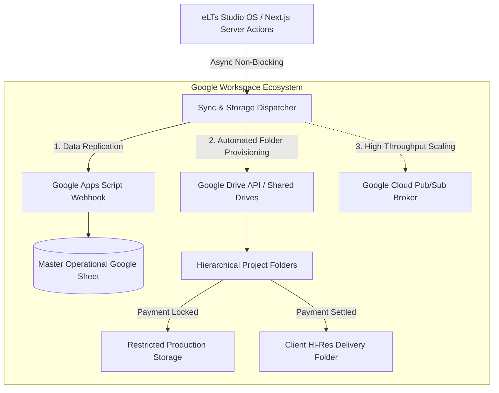
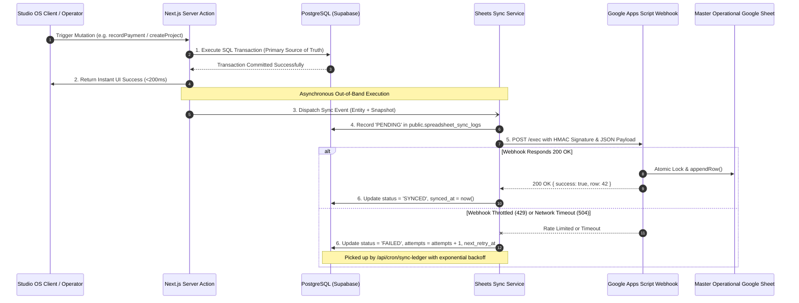

# Comprehensive Architecture & Technical Blueprint: Google Ecosystem Integration & Automated Sync Ledger

> **System:** eLTs Visual Studio OS (`elts-photography@2.2.0`)  
> **Status:** Production Architecture Specification & Execution Blueprint  
> **Author:** Principal Cloud Architect & Systems Integration Engineer  
> **Target Date:** Q4 2026 / Fiscal Year 2027  
> **Related Artifacts:**  
> - Database Migration: [`supabase/migrations/0034_notification_and_sync_ledger.sql`](file:///Users/ray/ELT./web/elts/supabase/migrations/0034_notification_and_sync_ledger.sql)  
> - GAS Deployment Script: [`docs/google-apps-script-sync-template.js`](file:///Users/ray/ELT./web/elts/docs/google-apps-script-sync-template.js)  
> - Notification & Sync Blueprint: [`docs/hybrid-notification-and-spreadsheet-sync-blueprint.md`](file:///Users/ray/ELT./web/elts/docs/hybrid-notification-and-spreadsheet-sync-blueprint.md)  

---

## 1. Google Ecosystem Capability Analysis

To transcend basic spreadsheet recording and turn the Google Workspace environment into an automated operational asset, eLTs Studio OS evaluates three pillars:



### 1.1 Google Drive API & Workspace Shared Drives

#### A. Automated Folder Hierarchy Provisioning
Manual folder creation by studio crew leads to inconsistent naming, missing files, and broken client links. The Google Drive API integration automates directory scaffolding the instant a project transitions to `ready`:

```
eLTs Shared Drive /
├── 2026 /
│   ├── EVENT_GRADUATION_PHOTO /
│   │   └── PRJ-202610-0042_Universitas-Indonesia_Budi/
│   │       ├── 01_RAW_Capture/          (Restricted: Photographers write-only)
│   │       ├── 02_Selection_Proofs/     (Watermarked WebP thumbnails for gallery)
│   │       └── 03_Final_Deliverables/   (Payment-Gated: Hi-Res JPEGs & Video cuts)
│   └── BROADCAST_COMMERCIAL/
│       └── PRJ-202610-0043_Gojek_Brand-Campaign/
│           ├── 01_Audio_Stems/
│           ├── 02_Camera_Footage/
│           └── 03_Master_Export/
```

#### B. Permission Gating & Asset Access Delegation
- **Pre-Payment State (`is_fully_paid = false`):**
  - The `03_Final_Deliverables` folder has zero public permissions.
  - Studio editors upload finished work, but the client access token or share link remains unissued.
- **Post-Payment State (`is_fully_paid = true`):**
  - Verified by `verifyReceipt()` in [`src/app/actions/invoice-receipts.ts`](file:///Users/ray/ELT./web/elts/src/app/actions/invoice-receipts.ts).
  - Triggers Drive API permission mutation: creates a `reader` permission for the client's email or generates a secure `viewUrl` stored in `projects.sector_specs.googleDriveUrl`.
  - The client portal gallery ([`src/components/client/gallery-grid.tsx`](file:///Users/ray/ELT./web/elts/src/components/client/gallery-grid.tsx)) automatically unhides the **"Unduh Master Google Drive"** button.

#### C. Storage Lifecycle & Cold Archival
- Shared Drives provide pooled enterprise storage without individual user storage caps.
- After $90$ days from project completion (`status = 'archived'`), an automated lifecycle rule flags the `01_RAW_Capture` directory for cold storage archival or local NAS offloading, freeing up cloud quotas.

---

### 1.2 Integration Gateway: Google Apps Script (GAS) vs. Google Cloud REST API

| Feature / Metric | Google Apps Script (GAS) Webhook | Google Cloud REST API (Service Account) | Architecture Decision |
| :--- | :--- | :--- | :--- |
| **Authentication Setup** | Bearer secret or HMAC token (`X-ELTS-SYNC-SECRET`) | OAuth2 Service Account with private key JSON & JWT signing | **GAS for Sheets / Cloud API for Drive** |
| **Execution Context** | Runs inside owner's Workspace context; zero Drive permission handshakes | Requires explicit Domain-Wide Delegation in Google Workspace Admin | GAS requires zero Google Cloud IAM admin overhead |
| **Concurrency & Locking** | Native atomic locking via `LockService.getScriptLock()` prevents race conditions | Must implement manual range reservation or optimistic locking | GAS guarantees zero row overwrite collisions |
| **Serverless Cold Start** | $800\text{ms} - 1500\text{ms}$ HTTP response | $200\text{ms} - 500\text{ms}$ HTTP response | Both acceptable because sync is out-of-band |
| **Execution Limits** | 6 min timeout, 20,000 URL fetches/day | Google API quotas ($300$ req/min per project, $60$ req/min per user) | GAS quotas exceed studio needs ($50\text{--}200$ events/day) |

---

### 1.3 Event Queue Evaluation: Database Ledger vs. Google Cloud Pub/Sub

```
EVALUATION FINDING:
At the studio's projected operational scale (50–500 projects/month, ~5,000 sync events/month), 
deploying Google Cloud Pub/Sub introduces unnecessary DevOps overhead, message broker costs, 
and multi-cloud latency.

The optimal, battle-tested solution is the PostgreSQL Database Queue (public.spreadsheet_sync_logs 
from Migration 0034) processed via non-blocking Next.js background workers and a scheduled cron endpoint 
(/api/cron/sync-ledger). This guarantees 100% ACID consistency and full auditability with zero monthly infrastructure cost.
```

---

## 2. End-to-End Backup & Synchronization Plan

### 2.1 Complete Data Flow Architecture



### 2.2 Table-to-Sheet Mapping Specifications

#### 1. Entity: `projects` $\longrightarrow$ Tab: `Projects Master`
| Target Column | Source Field / Expression | Transformation / Formatting Rule |
| :--- | :--- | :--- |
| **Col A: Sync Timestamp** | `now()` | ISO 8601 formatted in Asia/Jakarta timezone (`yyyy-MM-dd HH:mm:ss`). |
| **Col B: Project ID** | `projects.id` | UUID string. |
| **Col C: Project Name** | `projects.name` | Clean trimmed string. |
| **Col D: Customer Name** | `customers.name` | Resolved via foreign key join. |
| **Col E: Customer Phone** | `customers.phone` | Normalized Indonesian phone (`08...` or `628...`). |
| **Col F: Service Pillar** | `projects.service_pillar` | Display label (e.g., `Wisuda & Event`, `Komersial & Siaran`). |
| **Col G: Shoot Date** | `projects.shoot_date` | `YYYY-MM-DD` or `Belum ditentukan`. |
| **Col H: Contract Value** | `projects.contract_value` | Numeric IDR integer. |
| **Col I: Project Status** | `projects.status` | State machine label (`draft`, `editing`, `ready`, `archived`). |
| **Col J: Proofing Magic Link** | `projects.access_token` | Deep link: `https://client.elts.co.id/proofing/<access_token>`. |
| **Col K: Selection Deadline**| `projects.selection_deadline`| Formatted Indonesian date or empty. |

#### 2. Entity: `project_invoices` $\longrightarrow$ Tab: `Invoices & Receivables`
| Target Column | Source Field / Expression | Transformation / Formatting Rule |
| :--- | :--- | :--- |
| **Col A: Sync Timestamp** | `now()` | Asia/Jakarta wall-clock timestamp. |
| **Col B: Invoice ID** | `project_invoices.id` | UUID string. |
| **Col C: Invoice Number** | `project_invoices.invoice_number`| Format: `INV/YYYY/MM/NNNN`. |
| **Col D: Project Name** | `projects.name` | Resolved via join. |
| **Col E: Customer Name** | `customers.name` | Resolved via join. |
| **Col F: Issue Date** | `project_invoices.issue_date` | Date string. |
| **Col G: Due Date** | `project_invoices.due_date` | Date string. |
| **Col H: Gross Contract** | `gross_contract_value` | Integer IDR amount. |
| **Col I: Minimum DP %** | `minimum_dp_pct` | Number (e.g., `50`). |
| **Col J: Is DP Paid** | `projects.is_dp_paid` | `YES` / `NO`. |
| **Col K: Is Fully Paid** | `projects.is_fully_paid` | `YES` / `NO`. |

#### 3. Entity: `invoice_payment_receipts` $\longrightarrow$ Tab: `Cash Receipts Ledger`
| Target Column | Source Field / Expression | Transformation / Formatting Rule |
| :--- | :--- | :--- |
| **Col A: Sync Timestamp** | `now()` | Asia/Jakarta wall-clock timestamp. |
| **Col B: Receipt ID** | `invoice_payment_receipts.id` | UUID string. |
| **Col C: Receipt Number** | `receipt_number` | Format: `RCP/YYYY/MM/NNNN`. |
| **Col D: Invoice Number** | `project_invoices.invoice_number`| Format: `INV/...`. |
| **Col E: Project Name** | `projects.name` | Resolved via join. |
| **Col F: Received At** | `received_at` | Payment timestamp. |
| **Col G: Amount IDR** | `amount` | Verified IDR integer. |
| **Col H: Payment Method** | `payment_method` | `BANK_TRANSFER`, `CASH`, `QRIS`, `CREDIT_CARD`. |
| **Col I: Bank Name** | `bank_name` | Bank name or payment gateway. |
| **Col J: Reference Number**| `reference_number` | Bank transfer reference or empty. |
| **Col K: Verified Status** | `verified_at` | `VERIFIED` or `PENDING`. |

#### 4. Entity: `editor_tasks` + Proofing $\longrightarrow$ Tab: `Proofing & Editor Queue`
| Target Column | Source Field / Expression | Transformation / Formatting Rule |
| :--- | :--- | :--- |
| **Col A: Sync Timestamp** | `now()` | Asia/Jakarta wall-clock timestamp. |
| **Col B: Project ID** | `projects.id` | UUID string. |
| **Col C: Project Name** | `projects.name` | Project title. |
| **Col D: Selected Count** | `editor_tasks.deliverable_count` | Number of client-selected photos. |
| **Col E: Quota Min-Max** | `quota_min - quota_max` | Quota string (e.g., `15 - 20`). |
| **Col F: Locked At** | `projects.selection_locked_at` | Submission timestamp. |
| **Col G: Assigned Editor** | `editor_tasks.assigned_editor_id`| Editor name or `Unassigned`. |
| **Col H: Task Status** | `editor_tasks.status` | `PENDING`, `IN_PROGRESS`, `REVIEW`, `COMPLETED`. |
| **Col I: Google Drive URL**| `sector_specs.googleDriveUrl` | Final deliverable Google Drive link. |

---

### 2.3 Rate Limit Management & Quota Protection

1. **Google Sheets API Quotas:**
   - 300 requests per minute per project.
   - 60 requests per minute per user.
2. **Exponential Backoff with Full Jitter Formula:**
   $$\text{Backoff}(attempt) = \text{random}(0, \min(\text{cap}, \text{base} \times 2^{attempt}))$$
   - Base = 2 seconds, Cap = 300 seconds (5 minutes).
3. **Batch Aggregation Mode:**
   - For bulk operations (e.g. initial migration or end-of-month reconciliations), the client sends a `BATCH` payload:
   ```json
   {
     "entityType": "BATCH",
     "items": [
       { "entityType": "PROJECT", "data": { ... } },
       { "entityType": "INVOICE", "data": { ... } }
     ]
   }
   ```
   The GAS webhook processes all rows in a single atomic `setValues()` call rather than individual `appendRow()` calls, consuming only **1 API request** for up to $500$ rows.

---

### 2.4 Cryptographic Security Architecture

To prevent unauthorized tampering, spam, or denial-of-service against the Google Apps Script Web App, every outbound request requires:

1. **Shared Secret Authorization:**
   - Evaluates `X-ELTS-SYNC-SECRET: <secret>` from `process.env.GOOGLE_SHEETS_SYNC_SECRET`.
2. **HMAC-SHA256 Payload Signature (`X-ELTS-SYNC-SIGNATURE`):**
   $$\text{Signature} = \text{HMAC-SHA256}(\text{bodyJSON}, \text{secret})$$
   The GAS webhook verifies that the body was signed by the official Next.js backend.
3. **Replay Window Protection (`X-ELTS-TIMESTAMP`):**
   - Injects the current UNIX timestamp (in seconds).
   - The receiver rejects any request where $|t_{\text{server}} - t_{\text{header}}| > 300\text{ seconds}$ (5 minutes).

---

## 3. Implementation Roadmap

### Phase 1: Client Service & Cryptographic Signer
- Build [`src/lib/sync/types.ts`](file:///Users/ray/ELT./web/elts/src/lib/sync/types.ts) defining synchronization entities, payload schemas, and sync options.
- Build [`src/lib/sync/sheets-client.ts`](file:///Users/ray/ELT./web/elts/src/lib/sync/sheets-client.ts) implementing HMAC-SHA256 signing, non-blocking fetch dispatch, and fallback logging into `public.spreadsheet_sync_logs`.

### Phase 2: Domain Action Hook Wiring
- Attach sync event dispatchers to core Server Actions:
  - `createProjectDraftAction` & `completeProjectScaffoldAction` $\to$ `syncProjectToSheets`
  - `generateProjectInvoiceAction` $\to$ `syncInvoiceToSheets`
  - `verifyReceipt` $\to$ `syncPaymentReceiptToSheets`
  - `submitPhotoSelection` $\to$ `syncProofingSelectionToSheets`

### Phase 3: Automated Google Drive Scaffolding
- Implement directory provisioning logic that executes when a project is initialized.
- Generate standard subfolders (`01_RAW_Capture`, `02_Selection_Proofs`, `03_Final_Deliverables`).
- Update `sector_specs.googleDriveUrl` automatically with the created deliverables folder URL.

### Phase 4: Reconciliation Cron Engine
- Implement [`src/app/api/cron/sync-ledger/route.ts`](file:///Users/ray/ELT./web/elts/src/app/api/cron/sync-ledger/route.ts) protected by `CRON_SECRET`.
- Scans `public.spreadsheet_sync_logs` for `PENDING` or `FAILED` rows with `attempts < 3`.
- Retries synchronization with exponential backoff.

### Phase 5: Verification & End-to-End Testing
- Write automated contract tests verifying:
  - HMAC-SHA256 signature verification.
  - Replay window protection.
  - Fail-safe isolation (verifying database mutations succeed even if the spreadsheet webhook fails).
- Quality gates: `npm run typecheck`, `npm run lint`, and full test suite verification.
