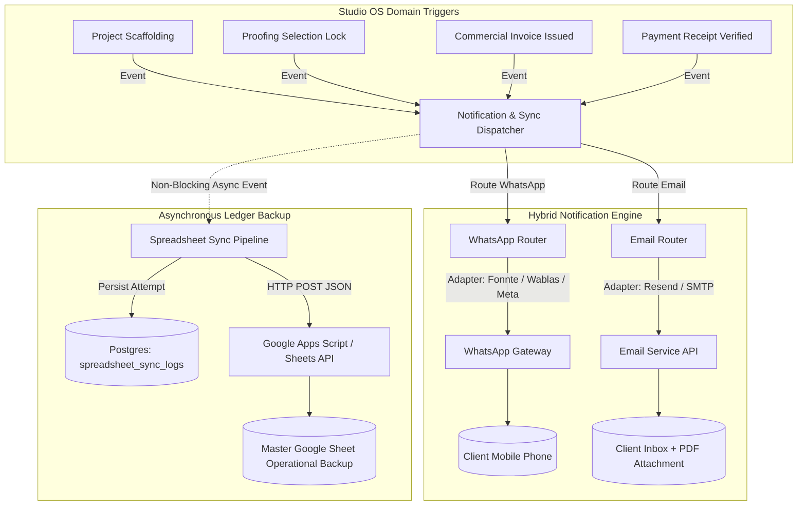
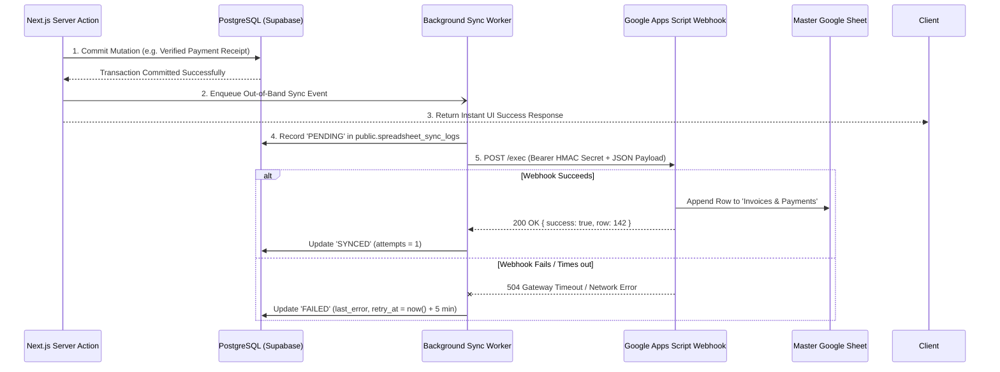
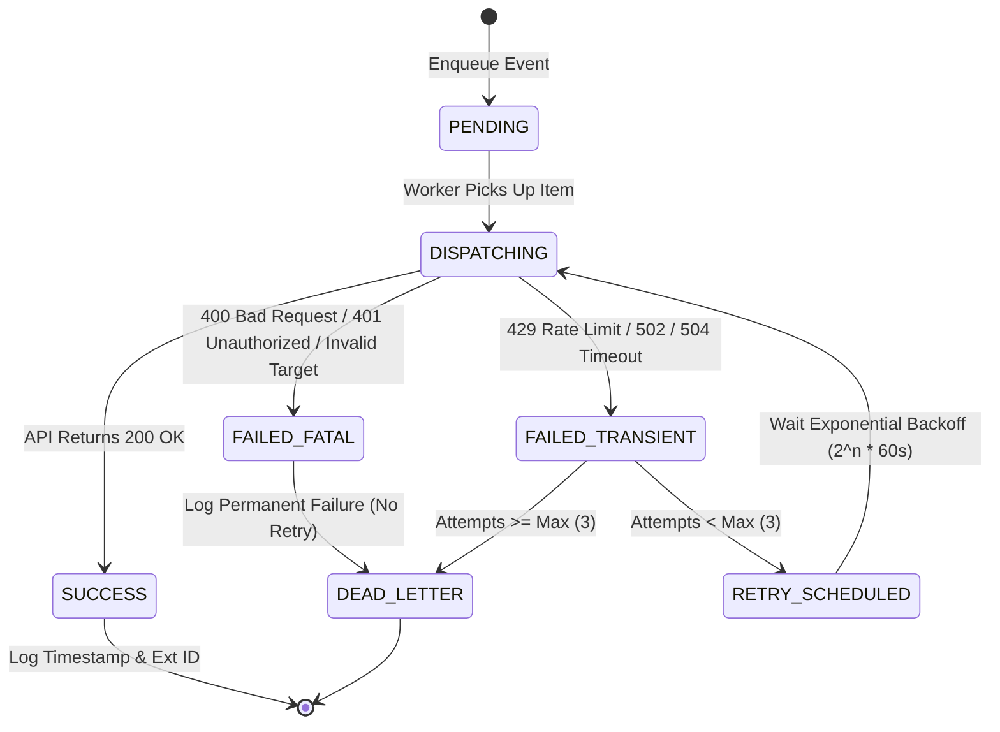

# Architectural Blueprint: Hybrid Notification Engine & Automated Spreadsheet Backup Ledger

> **System:** eLTs Visual Studio OS (`elts-photography@2.2.0`)  
> **Status:** Architecture Blueprint & Implementation Specification  
> **Author:** Principal System Architect & Lead Engineer  
> **Target Delivery Date:** Q4 2026  
> **Database Migration:** [`supabase/migrations/0034_notification_and_sync_ledger.sql`](file:///Users/ray/ELT./web/elts/supabase/migrations/0034_notification_and_sync_ledger.sql)  

---

## 1. Executive Architecture Overview

To scale studio operations, client delight, and financial transparency, eLTs Studio OS requires two enterprise-grade infrastructure components:

1. **A Hybrid Notification Engine:** An abstracted, provider-agnostic multi-channel dispatch service that unifies **WhatsApp** (time-sensitive, transactional, client-facing messaging) and **Email** (formal, legal, PDF-attached documentation).
2. **An Automated Spreadsheet Backup & Sync Ledger:** A secondary, decoupled, out-of-band data replication pipeline that mirrors operational entities (`projects`, `invoices`, `payments`, `client selections`) to a Google Sheets Master Ledger without ever blocking or jeopardizing PostgreSQL ACID transactions.



---

## 2. Subsystem 1: Hybrid Notification Engine

### 2.1 Design Principles & Requirements
- **Channel Specialization:**
  - **WhatsApp:** High open rates, low latency. Reserved for actionable touchpoints: magic link gallery delivery (`client.elts.co.id/proofing/<token>`), deadline warnings, and event callsheets.
  - **Email:** Archival record, high-payload delivery. Reserved for PDF commercial invoices, official receipts, and terms/contracts.
- **Provider Abstraction:** The core business actions must never import a vendor SDK (e.g. `nodemailer` or `fonnte`) directly. All dispatches invoke generic interfaces (`WhatsAppProvider` and `EmailProvider`).
- **Fail-Safe & Idempotency:** Notifications record unique `idempotency_key` identifiers in `public.notification_logs` to avoid accidental duplicate messages to clients.

### 2.2 Provider Contracts & Interfaces

```typescript
// Location: src/lib/notifications/types.ts

export type NotificationChannel = "WHATSAPP" | "EMAIL";

export type NotificationTrigger =
  | "PROOFING_DELIVERY_MAGIC_LINK"
  | "PROOFING_DEADLINE_WARNING"
  | "SELECTION_CONFIRMATION"
  | "INVOICE_ISSUED"
  | "PAYMENT_RECEIPT_CONFIRMED"
  | "SHOOT_CALLSHEET_T_MINUS_1";

export interface NotificationAttachment {
  filename: string;
  content: Buffer | string; // Base64 or raw Buffer
  contentType: string;
}

export interface SendWhatsAppOptions {
  recipientPhone: string;
  messageText: string;
  mediaUrl?: string;
  metadata?: Record<string, unknown>;
}

export interface SendEmailOptions {
  recipientEmail: string;
  recipientName?: string;
  subject: string;
  htmlBody: string;
  textBody?: string;
  attachments?: NotificationAttachment[];
  metadata?: Record<string, unknown>;
}

export interface NotificationResult {
  success: boolean;
  provider: string;
  externalMessageId?: string;
  error?: string;
  timestamp: string;
}

/** Abstract WhatsApp Gateway Contract */
export interface IWhatsAppProvider {
  name: string;
  sendMessage(opts: SendWhatsAppOptions): Promise<NotificationResult>;
}

/** Abstract Transactional Email Gateway Contract */
export interface IEmailProvider {
  name: string;
  sendEmail(opts: SendEmailOptions): Promise<NotificationResult>;
}
```

### 2.3 Provider Implementations

1. **WhatsApp Gateways:**
   - **Fonnte Adapter (`FonnteWhatsAppProvider`):** Direct REST API integration via `https://api.fonnte.com/send` using API token. Supports country-code auto-formatting (`08...` $\to$ `628...` via `src/lib/whatsapp/phone.ts`).
   - **Meta Cloud API Adapter (`MetaWhatsAppProvider`):** Official WhatsApp Business Platform API via Graph API `/v20.0/{phone_number_id}/messages` with pre-approved template namespaces.
   - **Console / Mock Adapter (`MockWhatsAppProvider`):** Deterministic mock for development and test execution.
2. **Email Gateways:**
   - **Resend Adapter (`ResendEmailProvider`):** Modern developer-first transactional API via `https://api.resend.com/emails` with native PDF attachment support.
   - **Nodemailer / SMTP Adapter (`SmtpEmailProvider`):** Direct connection to standard studio SMTP mailboxes (`hallo.elts@gmail.com`).

### 2.4 Trigger & Template Matrix

| Trigger Event | Target Channel | Template Strategy | Dynamic Payload |
| :--- | :--- | :--- | :--- |
| **Proofing Delivery** | **WhatsApp** | `PROOFING_MAGIC_LINK` | Client Name, Project Name, Magic Link URL (`https://client.elts.co.id/proofing/<token>`), Quota Range (`15-20`), Selection Deadline. |
| **Selection Deadline** | **WhatsApp** | `DEADLINE_COUNTDOWN` | Client Name, Remaining Days/Hours, Direct Link, Warning of auto-archive. |
| **Selection Confirmed** | **WhatsApp** | `SELECTION_LOCKED` | Client Name, Deliverable Count, Editor Queue Status, Estimated Finalization Date. |
| **Commercial Invoice** | **Email** | `INVOICE_ATTACHED_HTML` | Client Name, Invoice Number, Gross Amount, Minimum DP %, Due Date, Verification QR Code, **Attached Invoice PDF**. |
| **Payment Receipt** | **Email** | `RECEIPT_CONFIRMATION_HTML` | Receipt Number, Payment Method, Amount (IDR), Cleared Status, Updated Balance Due. |

---

## 3. Subsystem 2: Automated Spreadsheet Backup & Sync Ledger

### 3.1 Design Philosophy: The Secondary Read-Only Ledger
The primary source of truth for eLTs is **PostgreSQL on Supabase**. The Google Sheets integration is strictly an **asynchronous replica** designed for:
1. Executive operational visibility without granting Supabase DB access to non-technical partners.
2. An off-site immutable operational backup in case of disaster recovery.
3. Offline viewing and spreadsheet pivot reporting (revenue per photographer, monthly lead volume, outstanding receivables).

```
CRITICAL ARCHITECTURAL INVARIANT:
The spreadsheet synchronization must NEVER run synchronously inside a PostgreSQL transaction or Next.js Server Action mutation. 
All sync dispatches are FIRE-AND-FORGET with a database-backed sync queue (or non-blocking background fetch) so third-party Google API latency (1000–3000ms) or rate limits NEVER degrade studio response times or fail client checkouts.
```

### 3.2 Synchronization Architecture (Google Apps Script Webhook vs. REST API)

While the official Google Sheets API v4 is supported, the recommended primary integration pattern for eLTs is a **Protected Google Apps Script (GAS) Webhook**:



**Why Google Apps Script Webhook?**
- Zero complex OAuth2 refresh-token rotation in production serverless environments.
- High-security bearer secret validation (`X-ELTS-SYNC-SECRET`).
- Native atomic spreadsheet appending (`sheet.appendRow(...)`) that avoids cell-locking race conditions.

### 3.3 Target Google Sheet Structure (Master Workbook)

The workbook **`eLTs Studio OS - Master Operational Ledger`** consists of 4 segregated tabs:

#### Tab 1: `Projects Master`
| Col A | Col B | Col C | Col D | Col E | Col F | Col G | Col H | Col I | Col J |
| :--- | :--- | :--- | :--- | :--- | :--- | :--- | :--- | :--- | :--- |
| `Sync Timestamp` | `Project ID` | `Project Name` | `Customer Name` | `Pillar` | `Shoot Date` | `Contract IDR` | `Status` | `Proofing Magic Link` | `Selection Locked At` |

#### Tab 2: `Invoices & Receivables`
| Col A | Col B | Col C | Col D | Col E | Col F | Col G | Col H | Col I |
| :--- | :--- | :--- | :--- | :--- | :--- | :--- | :--- | :--- |
| `Sync Timestamp` | `Invoice No` | `Project Name` | `Issue Date` | `Due Date` | `Total IDR` | `DP Minimum IDR` | `Is DP Paid` | `Is Fully Paid` |

#### Tab 3: `Cash Receipts Ledger`
| Col A | Col B | Col C | Col D | Col E | Col F | Col G | Col H |
| :--- | :--- | :--- | :--- | :--- | :--- | :--- | :--- |
| `Sync Timestamp` | `Receipt No` | `Invoice No` | `Received At` | `Amount IDR` | `Payment Method` | `Bank Name` | `Verified By` |

#### Tab 4: `Proofing & Editor Queue`
| Col A | Col B | Col C | Col D | Col E | Col F | Col G |
| :--- | :--- | :--- | :--- | :--- | :--- | :--- |
| `Sync Timestamp` | `Project Name` | `Selected Count` | `Quota Min-Max` | `Assigned Editor` | `Task Status` | `Google Drive Deliverable URL` |

---

## 4. Database Schema Adjustments (Migration 0034)

To support complete observability, retry schedules, and auditability for both notifications and spreadsheet backup, we introduce **Migration `0034_notification_and_sync_ledger.sql`**.

```sql
-- Migration 0034: Notification Engine Logs & Spreadsheet Backup Sync Ledger
begin;

-- 1. Unified Notification Logs
create table if not exists public.notification_logs (
  id                  uuid primary key default gen_random_uuid(),
  channel             text not null check (channel in ('WHATSAPP', 'EMAIL')),
  trigger_type        text not null,
  recipient           text not null,
  subject_or_preview  text not null,
  provider            text not null,
  status              text not null default 'PENDING' check (status in ('PENDING', 'SENT', 'FAILED', 'DELIVERED')),
  project_id          uuid references public.projects(id) on delete set null,
  invoice_id          uuid references public.project_invoices(id) on delete set null,
  payload_json        jsonb not null default '{}'::jsonb,
  external_id         text,
  error_message       text,
  retry_count         integer not null default 0,
  next_retry_at       timestamptz,
  created_at          timestamptz not null default now(),
  dispatched_at       timestamptz
);

create index if not exists idx_notification_logs_status on public.notification_logs (status, next_retry_at);
create index if not exists idx_notification_logs_project on public.notification_logs (project_id);

-- 2. Spreadsheet Synchronization Ledger
create table if not exists public.spreadsheet_sync_logs (
  id                  uuid primary key default gen_random_uuid(),
  entity_type         text not null check (entity_type in ('PROJECT', 'INVOICE', 'PAYMENT_RECEIPT', 'PROOFING_SELECTION')),
  entity_id           uuid not null,
  action              text not null check (action in ('INSERT', 'UPDATE', 'DELETE')),
  sync_target         text not null default 'GOOGLE_SHEETS',
  status              text not null default 'PENDING' check (status in ('PENDING', 'SYNCED', 'FAILED')),
  payload_snapshot    jsonb not null,
  attempts            integer not null default 0,
  last_error          text,
  synced_at           timestamptz,
  created_at          timestamptz not null default now()
);

create index if not exists idx_sync_logs_pending on public.spreadsheet_sync_logs (status, created_at) where status = 'PENDING';
create index if not exists idx_sync_logs_entity on public.spreadsheet_sync_logs (entity_type, entity_id);

-- 3. RBAC Policies
alter table public.notification_logs enable row level security;
alter table public.spreadsheet_sync_logs enable row level security;

-- Only studio operations staff (rank >= 80) can inspect logs
create policy notification_logs_ops_read on public.notification_logs
  for select to authenticated
  using (private.has_role_rank(80));

create policy spreadsheet_sync_logs_ops_read on public.spreadsheet_sync_logs
  for select to authenticated
  using (private.has_role_rank(80));

commit;
```

---

## 5. Resilience, Error Handling & Backoff Strategy



1. **Exponential Backoff Formula:**
   $$\text{Delay}(n) = \min(3600, 60 \times 2^{n}) \pm \text{Jitter}$$
   - Attempt 1: 1 minute
   - Attempt 2: 4 minutes
   - Attempt 3: 16 minutes
   - Attempt > 3: Routed to Dead-Letter queue with notification to Studio Ops.
2. **Circuit Breaker:** If Google Sheets API or WhatsApp Provider returns three consecutive `429 Too Many Requests` or `5xx` responses, the dispatcher temporarily pauses outbound requests for 5 minutes, pooling events in `public.spreadsheet_sync_logs` with status `PENDING`.

---

## 6. Implementation Roadmap & Milestones

1. **Phase 1: Foundation & Data Layer (Day 1)**
   - Apply Migration `0034_notification_and_sync_ledger.sql`.
   - Implement `src/lib/notifications/types.ts` and `src/lib/sync/types.ts`.
   - Implement mock providers with automated test coverage.
2. **Phase 2: Hybrid Notification Engine (Days 2–3)**
   - Build `WhatsAppDispatcher` (`src/lib/notifications/whatsapp/`).
   - Build `EmailDispatcher` with PDF attachment streaming (`src/lib/notifications/email/`).
   - Wire WhatsApp triggers into `publishPortfolioPage`, proofing launch, and callsheet creation.
   - Wire Email triggers into invoice issuance and payment verification.
3. **Phase 3: Automated Spreadsheet Sync (Days 4–5)**
   - Implement Google Apps Script deployment template with Bearer Secret validation.
   - Implement `src/lib/sync/sheets-client.ts` with non-blocking fetch and automatic payload serialization.
   - Attach sync hooks to:
     - `createProjectAction`
     - `createInvoiceAction`
     - `recordPaymentReceiptAction`
     - `submitPhotoSelectionAction`
4. **Phase 4: Verification & Operational Console (Day 6)**
   - Add admin UI view in `/admin/settings/logs` to inspect notification and sync health.
   - Write end-to-end integration tests proving 100% fail-safe isolation (verifying DB actions succeed even if external APIs return 500 errors).
