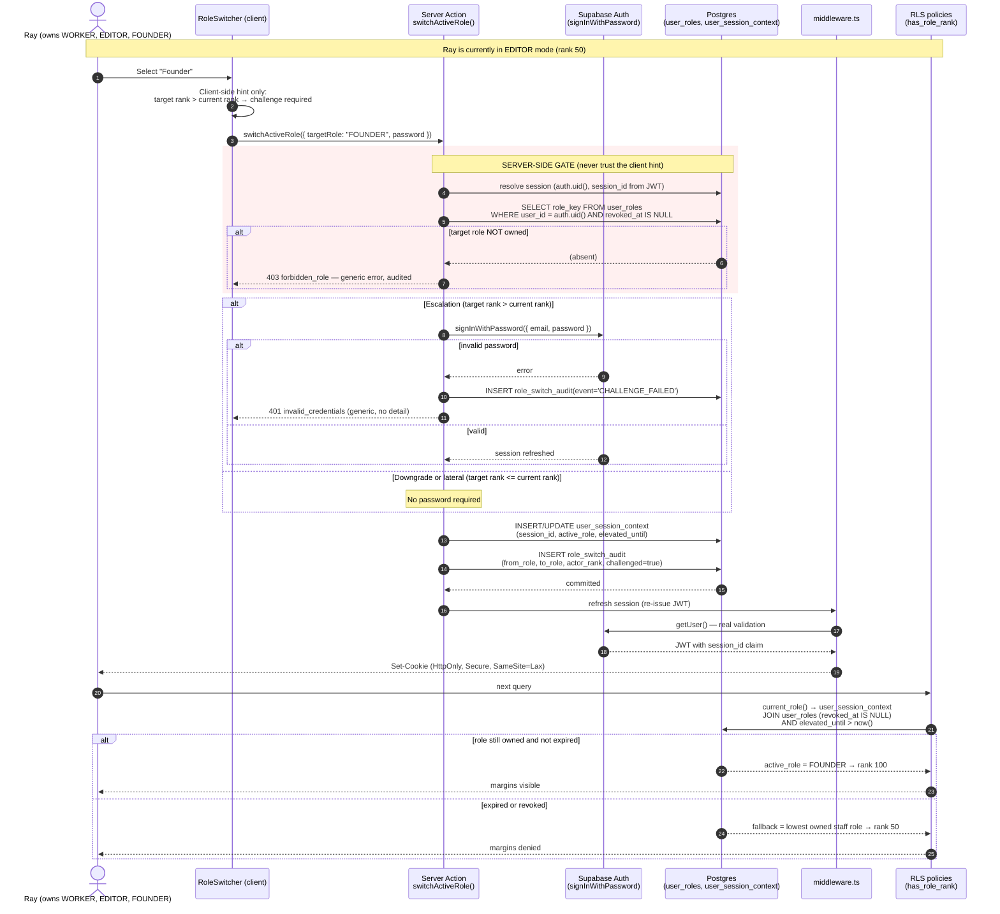

# RFC: Multi-Role Hybrid Structure, Password-Challenged Role Switching & Production Readiness

**Status:** Proposed — design only, no code or data changes
**Date:** 2026-10-20
**Scope:** `elts-photography` v2.2.0 · Next.js 16.3.5 · Supabase (PostgREST + RLS)
**Audience:** Principal architects, security reviewers, operators executing the cutover

---

## 0. Executive summary

The requested feature — a password-challenged role switcher — is **not a UI change**. It requires changing what "the caller's role" *means* in a database where 62 of 75 RLS policies derive authority from a single function. This RFC specifies that change end to end.

Three findings from the audit reshape the brief's assumptions. They are stated up front because designing against the stated baseline would produce a broken system:

| # | Brief assumed | Evidence from this repository | Consequence |
|---|---|---|---|
| 1 | Role switching is "unauthenticated" and lets users impersonate roles they don't own | `src/components/admin/role-switcher.tsx` is **downgrade-only, presentation-only, SUPER_ADMIN-gated (rank ≥ 120)**, and stores state in the URL (`?view_as=`), never in a cookie or session | The vulnerability described does not exist as stated. What exists is a **missing capability**, not an open door. The switcher cannot elevate, so there is nothing to "fix" — there is something to *build*. |
| 2 | Users hold multiple roles today | `public.role_assignments.user_id` is the **PRIMARY KEY** (`role_assignments_pkey`), so exactly one role per user is structurally enforced | The hybrid structure is **impossible in the current schema**. `ray -> WORKER + EDITOR + FOUNDER` cannot be represented. This is the real blocker, and it is a migration, not a config change. |
| 3 | `EDITOR` is one of the six roles | `public.roles` contains **six** roles: `CLIENT(10)`, `FREELANCER(30)`, `WORKER(60)`, `ADMIN(80)`, `FOUNDER(100)`, `SUPER_ADMIN(120)`. There is **no `EDITOR` role** | Adding `EDITOR` requires deciding its rank. This RFC proposes **rank 50** — below WORKER — and explains why, with the RLS consequences. |

The audit also surfaced **six live authorization defects** (§2) that must be fixed before this feature ships, because a role switcher built on top of them would give users a *false sense* of enforcement while service-role reads continue to bypass RLS entirely.

**Headline recommendation:** do not implement client-side role state. Put the active role in the **Supabase session's JWT** via a custom access-token hook, keyed on `session_id`, so that the existing 62 RLS policies keep working unchanged and become *session-scoped* rather than *account-scoped*. Password challenge is then a precondition for writing the elevated role into the session row — enforced server-side, not in the browser.

---

## 1. Current state (verified)

### 1.1 Authorization spine

```
auth.uid()  ──►  private.current_role()      ──►  private.current_role_rank()
                        │                                   │
                        │                                   └──► private.has_role_rank(int)  ──► 62 RLS policies
                        └──► public.get_caller_role()  ──► app guards (requireRole / requireOps / requireFounder)
```

Verified facts:

- `private.has_role_rank(p_min integer)` returns `current_role_rank() >= p_min`. **62 of 75** policies in `public` reference it.
- `private.has_permission(p_key)` **joins `role_assignments` directly** and does *not* consult `current_role()`. This is a divergence that must be unified (§4.4).
- `public.get_caller_role()` is `SECURITY DEFINER` and resolves the actor from `auth.uid()`; the app's guard layer reads rank through it. There is exactly one rank implementation — good.
- `public.v_staff_directory` is built on `role_assignments` and assumes one row per user (`ra.user_id` as the key).

### 1.2 The single-role constraint

```sql
-- verified via pg_constraint on public.role_assignments
role_assignments_pkey  PRIMARY KEY (user_id)
role_assignments_user_id_fkey  FOREIGN KEY (user_id) REFERENCES auth.users(id) ON DELETE CASCADE
role_assignments_role_key_fkey FOREIGN KEY (role_key) REFERENCES roles(key) ON DELETE RESTRICT
role_assignments_check CHECK ((revoked_at IS NULL) OR (revoked_at > granted_at))
CREATE INDEX role_assignments_role_idx ON role_assignments (role_key) WHERE revoked_at IS NULL;
```

`limit 1` appears in `current_role()` and `current_role_rank()` — a symptom of the same constraint. Even if the PK were dropped, an unordered `limit 1` would make rank resolution **non-deterministic**.

### 1.3 Existing switcher (do not delete — it solves a different problem)

`RoleSwitcher` manipulates **presentation only**. Its own header states the security model, and the implementation matches:

- `canPreview = actualRank >= ROLE_RANK.SUPER_ADMIN` — non-SUPER_ADMIN never receives it.
- State lives in the URL, so it "cannot be confused with real authority."
- The doc comment guarantees: *"The impersonated rank can never exceed the caller's real rank. A preview can show you LESS than you have, never more."*

That is a **debugging/preview affordance**, and it should be retained under a new name (`PreviewSwitcher`) to avoid confusing it with the new authority-bearing switcher. It is not the vulnerable dropdown described in the brief.

### 1.4 Live authorization defects found during the audit

These are **not** hypothetical. Each was confirmed by reading the code path.

| ID | Location | Defect | Severity |
|---|---|---|---|
| **A** | `src/app/actions/moodboard.ts` (`addMoodboardComment`, `addMoodboardCard`, `toggleShotListItem`, `deleteMoodboardCard`, `seedDefaultMoodboard`) | All six exported actions use `createServiceSupabase()` (**bypasses RLS**) with **zero** auth checks. `addMoodboardComment(cardId, content, authorRole, authorName)` accepts `authorRole` and `authorName` **from the caller** and writes them straight to the row. Any unauthenticated visitor can post a comment attributed to `"STUDIO"` / `"Studio Director"`. `deleteMoodboardCard` deletes by UUID with no ownership check. | **High** — unauthenticated write + identity spoofing |
| **B** | Same file | The *page* (`/gallery/[slug]/moodboard`) checks a gallery session, but the **Server Actions do not**. Server Actions are directly invocable endpoints; the page guard does not protect them. | **High** — guard bypass |
| **C** | 11 of 13 service-client modules | RLS is bypassed by design on the service client. Authorization therefore depends entirely on the in-action guard, and several modules have none or rely on the caller's page having been gated. A role switcher that changes *RLS rank* would have **no effect** on these paths. | **High** — false enforcement |
| **D** | `private.has_permission()` vs `private.current_role()` | Permission checks join `role_assignments` directly and ignore session context. Once active-role switching exists, `has_role_rank()` and `has_permission()` would disagree. | **Medium** — privilege inconsistency |
| **E** | `private.prevent_self_role_grant()` | Blocks self-grant only when `new.role_key <> coalesce(old.role_key,'')`. With one row per user this is coherent; with a junction table it must be re-expressed per-role, or a user could insert a second row for themselves. | **Medium** — becomes exploitable after migration |
| **F** | `private.legacy_admin_rank()` fallback | Any user in `public.admins` absent from `role_assignments` resolves to **ADMIN (80)**. Four accounts are currently in `admins`. Once multi-role lands, this fallback can silently promote a user who was deliberately given only `FREELANCER`. | **Medium** — latent escalation |

**Defect A is the actual security vulnerability in this area.** It should be fixed regardless of whether role switching is ever built.

---

## 2. Threat model

### 2.1 Assets

| Asset | Why it matters |
|---|---|
| `project_expenses`, `project_profit_snapshots`, `money_splits`, `cash_ledger`, `invoice_payment_receipts` | Margins, profit splits, partner equity. RLS-gated at rank ≥ 100. |
| `payroll_cycles`, `payslip_records`, `compensation_line_items` | Salaries and payouts. |
| `role_assignments`, `role_permissions` | Authority itself. |
| Partner bank details (`crew_members.bank_*`, `studio_payment_methods.*`) | Financial fraud / payout redirection. |
| Session tokens | Full account takeover if stolen. |

### 2.2 Adversaries

| Adversary | Capability | Relevant control |
|---|---|---|
| **Malicious insider (WORKER)** | Valid credentials, low privilege | Cannot self-grant a role; active role is server-asserted, never client-supplied |
| **Compromised FOUNDER session** | Valid elevated session, e.g. stolen cookie | Cannot mint SUPER_ADMIN; elevation is time-boxed and re-challenged |
| **XSS in admin surface** | Can call Server Actions as the victim | Password challenge raises the cost of silent escalation; active role is in an HttpOnly cookie, unreadable by script |
| **Unauthenticated visitor** | Network access | Defect A currently defeats this boundary entirely |
| **Replay of a stale elevated context** | Old cookie/JWT | Elevation TTL + `session_id` binding + revocation check |

### 2.3 Threat → control matrix for the switcher

| Threat | Control |
|---|---|
| Client sends `role=FOUNDER` without owning it | Server resolves owned roles from `user_roles`; the request's role is **never** trusted. Only a server-written session row can carry an elevated role. |
| User escalates by editing the cookie | Cookie is `HttpOnly` + `Secure` + `SameSite=Lax` and **signed**; the authoritative copy lives in `auth.sessions`/`user_session_context`, not in the cookie. |
| Elevation persists forever after a shared machine | `elevated_until` TTL (default 30 min); expiry silently demotes to the user's lowest staff role. |
| Password guessing via the challenge | Per-user + per-IP throttle; constant-time compare; generic error; audit every attempt. |
| Password challenge as an oracle for a *different* user's password | Challenge verifies **the caller's own** credentials only; target role must already be owned. |
| Downgrade used to evade audit | Every switch (up or down) writes an immutable audit row with `actor_rank` at time of action — the pattern `payroll_audit_log` already uses. |
| Confused deputy via `has_permission()` | Unify both functions on the same session-aware resolver (§4.4). |
| Role revoked mid-session but still active in JWT | Session-context lookup joins `user_roles` and requires `revoked_at IS NULL` **on every request**; a revoked role collapses to the fallback immediately. |

### 2.4 Explicit non-goals

- Preventing a FOUNDER from reading margins **in the database**. A FOUNDER who owns the role can always switch back. The control is *auditability and friction*, not capability removal. Stated plainly so no one mistakes it for a hard boundary.
- Protecting against a compromised **service-role key**. That key bypasses RLS by definition; §7 addresses reducing its blast radius.

---

## 3. Sequence diagram — password-challenged role switching



### 3.1 Why the challenge must be server-side

The client may render a password modal, but the modal is **decoration**. The security property comes from one fact: *the only way to write `active_role` into `user_session_context` is through a `SECURITY DEFINER` function that has just verified the password.* The browser never holds the ability to set its own rank.

### 3.2 Why `signInWithPassword` and not a bespoke verifier

`supabase.auth.signInWithPassword()` is the correct primitive:

- It verifies against GoTrue's own credential store — no second password hash to keep in sync, no custom crypto.
- It rotates the session, so the resulting JWT is freshly minted and legitimately reflects "this person just proved they are this person."
- It composes with `supabase.auth.reauthenticate()` (present in `@supabase/auth-js` 2.116.0) for the *Secure password change* path in §6.

A bespoke "verify-credentials" RPC would need access to the password hash, which is not exposed to PostgREST. Reject that approach.

**Caveat to record:** `signInWithPassword` issues a *new* session. The implementation must preserve the current session's identity and then update the **existing** `session_id`'s context, or deliberately adopt the new session and write context to it. Mixing the two silently produces a session whose `session_id` has no context row — which must be treated as **fallback rank**, not elevated rank (fail closed).

---

## 4. Database schema (DDL)

All migrations are additive and wrapped in a transaction. Numbering continues from `0018`.

### 4.1 `0019_user_roles_junction.sql` — break the single-role constraint

```sql
begin;

/*
 * WHY A NEW TABLE RATHER THAN DROPPING THE PK ON role_assignments
 * ---------------------------------------------------------------
 * role_assignments is read by v_staff_directory, has_permission(), the
 * self-grant trigger, and the SUPER_ADMIN write policy. Mutating its shape in
 * place would break all four in one step, with no way to roll back a partially
 * applied migration on a live database. A new table lets both models coexist
 * for exactly one deploy, which is the window in which we verify the backfill.
 */

create table if not exists public.user_roles (
  id           uuid primary key default gen_random_uuid(),
  user_id      uuid not null references auth.users(id) on delete cascade,
  role_key     text not null references public.roles(key) on delete restrict,
  granted_by   uuid references auth.users(id) on delete set null,
  granted_at   timestamptz not null default now(),
  revoked_at   timestamptz,
  -- A role is held at most once, and only one live grant per (user, role).
  constraint user_roles_unique_live unique (user_id, role_key),
  constraint user_roles_revoked_after_grant
    check (revoked_at is null or revoked_at > granted_at)
);

comment on table public.user_roles is
  'Junction of accounts to roles. Replaces the one-row-per-user role_assignments.';

-- Partial index: rank resolution only ever reads live grants.
create index if not exists user_roles_live_idx
  on public.user_roles (user_id)
  where revoked_at is null;

create index if not exists user_roles_role_idx
  on public.user_roles (role_key)
  where revoked_at is null;

-- Backfill from the single-role table.
insert into public.user_roles (user_id, role_key, granted_by, granted_at)
select ra.user_id, ra.role_key, ra.granted_by, ra.granted_at
from public.role_assignments ra
where ra.revoked_at is null
on conflict (user_id, role_key) do nothing;

commit;
```

**Note on `unique (user_id, role_key)` with soft deletes:** a revoked-then-regranted role would collide with the old row. Either (a) hard-delete on revoke, or (b) use a partial unique index `where revoked_at is null` and keep history. This RFC recommends **(b)** — audit value outweighs the extra row:

```sql
alter table public.user_roles drop constraint user_roles_unique_live;
create unique index user_roles_unique_live_idx
  on public.user_roles (user_id, role_key)
  where revoked_at is null;
```

### 4.2 `0020_session_context.sql` — where the active role lives

```sql
begin;

/*
 * The active role is bound to a SESSION, not to a user.
 *
 * Binding to the user would let one browser tab's elevation leak into every
 * other session for that account, and would survive sign-out. Binding to
 * auth.sessions.id — which is already present as the `session_id` JWT claim in
 * @supabase/auth-js 2.116.0 — gives per-device, revocable, TTL-bounded scope.
 */
create table if not exists public.user_session_context (
  session_id    uuid primary key references auth.sessions(id) on delete cascade,
  user_id       uuid not null references auth.users(id) on delete cascade,
  active_role   text not null references public.roles(key) on delete restrict,
  -- NULL = not elevated. Non-null = the moment elevation lapses.
  elevated_until timestamptz,
  -- How the active role was established, for audit reconstruction.
  established_by text not null default 'LOGIN'
    check (established_by in ('LOGIN','SWITCH','DOWNGRADE','CHALLENGE')),
  updated_at    timestamptz not null default now(),
  -- An elevated context MUST carry an expiry. A row claiming elevation with
  -- no deadline is a bug, and this makes it unrepresentable.
  constraint user_session_context_elevation_has_ttl
    check (elevated_until is not null or established_by <> 'CHALLENGE')
);

create index if not exists user_session_context_user_idx
  on public.user_session_context (user_id);

comment on table public.user_session_context is
  'Per-session active role. Written only by SECURITY DEFINER functions.';

alter table public.user_session_context enable row level security;

-- A user may read their own session context (the UI needs it to render the
-- correct shell). No direct writes: all writes go through the RPCs below.
drop policy if exists user_session_context_read_self on public.user_session_context;
create policy user_session_context_read_self on public.user_session_context
  for select to authenticated
  using (user_id = (select auth.uid()));

-- Deliberately NO insert/update/delete policy for `authenticated`:
-- writes are only possible via the SECURITY DEFINER functions in 0021.

commit;
```

### 4.3 `0021_session_aware_resolvers.sql` — the single point of substitution

```sql
begin;

/*
 * Resolve the ACTIVE role for the current session.
 *
 * Order of precedence:
 *   1. A session context row whose role is STILL held (revoked_at is null)
 *      and, when elevated, not expired.
 *   2. Otherwise the highest-ranked live role the user holds.
 *   3. Otherwise the legacy fallback (see 0022).
 *
 * Every branch fails CLOSED: an unknown session, a revoked role, or an expired
 * elevation all collapse to a lower rank — never to a higher one.
 */
create or replace function private.current_role() returns text
language sql stable security definer set search_path = '' as $$
  with session_role as (
    select c.active_role
    from public.user_session_context c
    join public.user_roles ur
      on ur.user_id = c.user_id
     and ur.role_key = c.active_role
     and ur.revoked_at is null
    where c.session_id = (select auth.jwt() ->> 'session_id')::uuid
      and c.user_id   = (select auth.uid())
      and (c.elevated_until is null or c.elevated_until > now())
    limit 1
  ),
  best_owned as (
    select ur.role_key
    from public.user_roles ur
    join public.roles r on r.key = ur.role_key
    where ur.user_id = (select auth.uid())
      and ur.revoked_at is null
    order by r.rank desc
    limit 1
  )
  select coalesce(
    (select active_role from session_role),
    (select role_key    from best_owned),
    case when private.legacy_admin_rank() > 0 then 'ADMIN' else null end
  );
$$;

/*
 * Rank is derived from current_role() ONLY. There is exactly one resolution
 * path, so has_role_rank() and get_caller_role() cannot disagree.
 */
create or replace function private.current_role_rank() returns smallint
language sql stable security definer set search_path = '' as $$
  select coalesce(
    (select r.rank from public.roles r where r.key = private.current_role()),
    0::smallint
  );
$$;

/*
 * Permission checks MUST consult the same active role. The previous version
 * joined role_assignments directly, which after this change would grant the
 * union of every owned role — silently defeating downgrade.
 */
create or replace function private.has_permission(p_key text) returns boolean
language sql stable security definer set search_path = '' as $$
  select exists (
    select 1
    from public.role_permissions rp
    where rp.role_key = private.current_role()
      and rp.permission_key = p_key
  );
$$;

commit;
```

**This is the entire RLS blast radius.** Because all 62 policies call `has_role_rank()`, and `has_role_rank()` calls `current_role_rank()`, replacing `current_role()` changes every policy at once. No policy file needs to be touched.

### 4.4 `0022_user_profiles_and_payouts.sql`

```sql
begin;

create table if not exists public.user_profiles (
  user_id          uuid primary key references auth.users(id) on delete cascade,
  full_name        text not null check (length(btrim(full_name)) between 1 and 120),
  display_name     text check (display_name is null or length(btrim(display_name)) between 1 and 60),
  phone            text check (phone is null or phone ~ '^\+?[0-9][0-9\-\s]{6,19}$'),
  avatar_url       text,
  -- Payout: required for automated payslips. Stored here, NOT on
  -- crew_members, so a staff member without a crew row still has a payout
  -- destination.
  bank_name            text,
  bank_account_holder  text,
  bank_account_number  text,
  ewallet_provider     text,
  ewallet_id           text,
  -- Payout details are financial PII: readable only by the owner and FOUNDER.
  created_at       timestamptz not null default now(),
  updated_at       timestamptz not null default now(),
  constraint user_profiles_payout_complete
    check (
      (bank_name is null and bank_account_holder is null and bank_account_number is null)
      or (bank_name is not null and bank_account_holder is not null and bank_account_number is not null)
    )
);

alter table public.user_profiles enable row level security;

drop policy if exists user_profiles_read_self on public.user_profiles;
create policy user_profiles_read_self on public.user_profiles
  for select to authenticated
  using (user_id = (select auth.uid()) or private.has_role_rank(100));

drop policy if exists user_profiles_write_self on public.user_profiles;
create policy user_profiles_write_self on public.user_profiles
  for update to authenticated
  using (user_id = (select auth.uid()))
  with check (user_id = (select auth.uid()));

drop policy if exists user_profiles_insert_self on public.user_profiles;
create policy user_profiles_insert_self on public.user_profiles
  for insert to authenticated
  with check (user_id = (select auth.uid()));

-- updated_at maintenance, reusing the existing helper.
drop trigger if exists user_profiles_updated_at on public.user_profiles;
create trigger user_profiles_updated_at
  before update on public.user_profiles
  for each row execute function private.set_updated_at();

commit;
```

### 4.5 `0023_role_switch_rpc_and_audit.sql`

```sql
begin;

create table if not exists public.role_switch_audit (
  id           bigserial primary key,
  user_id      uuid not null references auth.users(id) on delete cascade,
  session_id   uuid,
  from_role    text,
  to_role      text,
  actor_rank   smallint not null,
  event        text not null check (event in
                 ('SWITCH','DOWNGRADE','CHALLENGE_FAILED','CHALLENGE_OK','EXPIRED','REVOKED')),
  detail       jsonb not null default '{}'::jsonb,
  created_at   timestamptz not null default now()
);

create index if not exists role_switch_audit_user_idx
  on public.role_switch_audit (user_id, created_at desc);

alter table public.role_switch_audit enable row level security;

-- Audit is append-only and readable by SUPER_ADMIN only.
drop policy if exists role_switch_audit_read on public.role_switch_audit;
create policy role_switch_audit_read on public.role_switch_audit
  for select to authenticated
  using (private.has_role_rank(120));

-- Reuse the existing immutability pattern from payroll_audit_log.
drop trigger if exists trg_role_switch_audit_immutable on public.role_switch_audit;
create trigger trg_role_switch_audit_immutable
  before update or delete on public.role_switch_audit
  for each row execute function private.reject_audit_mutation();

/*
 * set_active_role: the ONLY writer of user_session_context.
 *
 * Password verification happens in the application via Supabase Auth before
 * this is called; this function enforces the invariant the app cannot be
 * trusted with — that the target role is actually held by the caller.
 *
 * p_challenged records whether a password was verified, and the TTL check
 * below refuses to grant a long-lived elevation without one.
 */
create or replace function public.set_active_role(
  p_target_role text,
  p_challenged  boolean
) returns table (active_role text, active_rank smallint, elevated_until timestamptz)
language plpgsql security definer set search_path = '' as $$
declare
  v_uid         uuid := (select auth.uid());
  v_session     uuid := (select auth.jwt() ->> 'session_id')::uuid;
  v_target_rank smallint;
  v_holds       boolean;
  /*
   * Captured ONCE, before any write.
   *
   * `current_role_rank()` is session-derived. Calling it again after the
   * `user_session_context` upsert below would read the NEW role, so an
   * escalation would be labelled 'DOWNGRADE' in the audit row and the
   * escalation check would compare the target against itself. Both are
   * silent-wrong-answer bugs, so the prior rank is snapshotted here.
   */
  v_prior_rank  smallint := coalesce(private.current_role_rank(), 0);
  v_is_escalation boolean;
  v_current     text := private.current_role();
  v_ttl         interval;
begin
  if v_uid is null or v_session is null then
    raise exception 'No authenticated session' using errcode = 'insufficient_privilege';
  end if;

  select r.rank into v_target_rank from public.roles r where r.key = p_target_role;
  if v_target_rank is null then
    raise exception 'Unknown role %', p_target_role using errcode = 'check_violation';
  end if;

  -- The caller must actually hold the role.
  select exists (
    select 1 from public.user_roles ur
    where ur.user_id = v_uid
      and ur.role_key = p_target_role
      and ur.revoked_at is null
  ) into v_holds;

  if not v_holds then
    raise exception 'Role not held' using errcode = 'insufficient_privilege';
  end if;

  /*
   * Escalation without a verified password is refused. Downgrade and lateral
   * moves never need one. `current_role()` may be NULL for a first-time
   * session, which is treated as rank 0 — so the very first switch into any
   * staff role requires a challenge, which is the safe default.
   */
  v_is_escalation := v_target_rank > v_prior_rank;

  if v_is_escalation and not p_challenged then
    raise exception 'Password challenge required for escalation'
      using errcode = 'insufficient_privilege';
  end if;

  /*
   * TTL applies ONLY to an escalation. A challenged downgrade must not inherit
   * an expiry, or the row would claim elevation it does not have and the
   * `elevated_until` column would stop meaning "elevated until".
   */
  v_ttl := case when v_is_escalation then interval '30 minutes' else null end;

  insert into public.user_session_context
    (session_id, user_id, active_role, elevated_until, established_by, updated_at)
  values
    (v_session, v_uid, p_target_role,
     case when v_ttl is null then null else now() + v_ttl end,
     case when v_is_escalation then 'CHALLENGE' else 'DOWNGRADE' end,
     now())
  on conflict (session_id) do update
    set active_role    = excluded.active_role,
        elevated_until = excluded.elevated_until,
        established_by = excluded.established_by,
        updated_at     = now();

  insert into public.role_switch_audit
    (user_id, session_id, from_role, to_role, actor_rank, event, detail)
  values
    (v_uid, v_session, v_current, p_target_role, v_target_rank,
     case when v_is_escalation then 'SWITCH' else 'DOWNGRADE' end,
     jsonb_build_object('challenged', p_challenged));

  return query
    select c.active_role, v_target_rank, c.elevated_until
    from public.user_session_context c
    where c.session_id = v_session;
end $$;

revoke all on function public.set_active_role(text, boolean) from public, anon;
grant execute on function public.set_active_role(text, boolean) to authenticated;

commit;
```

### 4.6 Replacing the now-wrong self-grant guard (defect E)

```sql
create or replace function private.prevent_self_role_grant()
returns trigger language plpgsql security definer set search_path = '' as $$
begin
  /*
   * Under the junction model, "granting yourself a role" is an INSERT of a new
   * (user_id, role_key) pair. The old check compared old/new role_key on a
   * single row and therefore does not fire for an INSERT at all.
   */
  if new.user_id = (select auth.uid()) then
    raise exception 'Self role escalation is not permitted'
      using errcode = 'insufficient_privilege';
  end if;
  return new;
end $$;
```

### 4.7 Removing the legacy fallback (defect F)

After backfill is verified, `private.legacy_admin_rank()` must stop granting 80 to `admins` rows that have no `user_roles` entry. Sequence it *after* the seed (§7) so no operator is locked out mid-cutover.

### 4.8 The `EDITOR` role question

`EDITOR` does not exist. Adding it is a **product decision with security consequences**, so it is called out rather than assumed:

| Option | Rank | Effect |
|---|---|---|
| **A (recommended)** | **50** | Below WORKER (60). An editor can read assigned `editor_tasks` but cannot reach `media_rbac_read` (rank ≥ 60) or any staff surface. Requires an explicit `editor_tasks` policy for rank 50. |
| B | 60 (alias of WORKER) | No new rank needed, but "switching to EDITOR" would then be a no-op for RLS and misleading in the UI. |
| C | 65 (above WORKER) | Editors gain `media` read and general staff reads. Simplest to implement, but grants more than the role implies. |

**Recommendation: A.** It is the only option where "Ray in EDITOR mode" genuinely evaluates to a *lower* privilege than WORKER, which is what the brief asks for ("zero visibility into project margins or equity" — already true at rank 50 *and* 60, but 50 also denies general media access). Option A requires one new policy:

```sql
-- EDITOR may read and update only the tasks assigned to them.
drop policy if exists editor_tasks_editor_self on public.editor_tasks;
create policy editor_tasks_editor_self on public.editor_tasks
  for all to authenticated
  using (
    private.current_role() = 'EDITOR'
    and (assigned_user_id = (select auth.uid()) or payee_user_id = (select auth.uid()))
  )
  with check (
    private.current_role() = 'EDITOR'
    and (assigned_user_id = (select auth.uid()) or payee_user_id = (select auth.uid()))
  );
```

---

## 5. Per-role dashboards, navigation, and data boundaries

### 5.1 The invariant

> The active role in `user_session_context` is the **only** input to navigation and dashboard composition. It is read server-side in the layout and passed down as a DTO. A client component never computes a rank.

### 5.2 Role matrix

| Capability | SUPER_ADMIN 120 | FOUNDER 100 | ADMIN 80 | WORKER 60 | **EDITOR 50** | FREELANCER 30 |
|---|---|---|---|---|---|---|
| Dashboard | System health, RBAC, flags, telemetry | Margin, cash, equity, approvals | Ops board, dispatch, invoices | My tasks, uploads | My edit queue | Call sheets (magic link) |
| Nav groups | All | Ops + Finance + Governance | Ops | Work | Work (narrow) | None (`/admin` denied) |
| Margins / expenses | ✔ | ✔ | ✘ | ✘ | ✘ | ✘ |
| Profit splits / equity | ✔ | ✔ | ✘ | ✘ | ✘ | ✘ |
| Invoice issue | ✔ | ✔ | ✔ | ✘ | ✘ | ✘ |
| Invoice settle | ✔ | ✔ | ✘ | ✘ | ✘ | ✘ |
| Role management | ✔ | ✘ | ✘ | ✘ | ✘ | ✘ |
| Payout release | ✔ | ✔ | ✘ | ✘ | ✘ | ✘ |

Grounded in the live `role_permissions` rows: `ADMIN` has `invoice.issue` but **not** `invoice.settle`; `FOUNDER` has `ledger.read`, `split.approve`, `payout.release`; `WORKER` has only `calendar.read, crew.read, gear.read, project.read, task.read, task.write`.

### 5.3 Routing

```
/admin                    → role-aware dispatcher (server) → renders one of:
    /admin/(dash)/system      rank ≥ 120
    /admin/(dash)/finance     rank ≥ 100
    /admin/(dash)/ops         rank ≥ 80
    /admin/(dash)/work        rank ≥ 50
```

The existing `visibleGroups(groups, rank)` filter is already the right primitive and should be fed the **active** rank instead of the account's maximum rank. Route handlers must additionally call `requirePageRole()` — nav filtering is not authorization.

### 5.4 Data boundaries the brief asks about

Verified policy predicates:

| Table | Current predicate | Ray in EDITOR (50) | Ray in FOUNDER (100) |
|---|---|---|---|
| `project_expenses` (SELECT) | `has_role_rank(100)` | **denied** | allowed |
| `project_profit_snapshots` | `has_role_rank(100)` | **denied** | allowed |
| `money_splits` | `has_role_rank(100)` | **denied** | allowed |
| `cash_ledger` | `has_role_rank(100)` | **denied** | allowed |
| `invoice_payment_receipts` | `has_role_rank(100)` | **denied** | allowed |
| `project_invoices` (SELECT) | `has_role_rank(80)` | denied | allowed |
| `media` (SELECT) | `has_role_rank(60)` | denied (rank 50) | allowed |
| `editor_tasks` (SELECT) | `rank ≥ 80 OR (rank ≥ 60 AND assigned)` | self-only via new policy | allowed |

So the brief's requirement — "when Ray is in EDITOR mode his queries must evaluate to rank 60 (zero visibility into project margins)" — is satisfied **more strictly** at rank 50: margins are denied, and so is general media access.

### 5.5 UI controls

- Sidebar footer shows the **active** role with a distinct "elevated" treatment and a countdown when `elevated_until` is set.
- The switcher lists only roles the user **holds**, resolved server-side and passed as a DTO.
- Escalating options are visually marked; selecting one opens the password modal.
- Downgrade is instant, no modal.
- `PreviewSwitcher` (the existing component) is retained but renamed, rendered only when the **active** role is SUPER_ADMIN, and clearly labelled "Preview (no authority)".

---

## 6. Profile, payout, and credential CRUD

### 6.1 Routes

```
/settings/profile    → full_name, display_name, phone, payout
/settings/security   → password change, email change, active sessions
```

Both are available to **every authenticated staff member** — a WORKER must be able to set a bank account or their payslip has nowhere to go.

### 6.2 Server actions

```ts
// src/app/actions/profile.ts
"use server";

export async function updateProfileAction(input: {
  fullName: string;
  displayName?: string;
  phone?: string;
}): Promise<{ ok: true } | { ok: false; error: string }>;

export async function updatePayoutAction(input: {
  bankName: string;
  accountHolder: string;
  accountNumber: string;
  // or e-wallet variant
}): Promise<{ ok: true } | { ok: false; error: string }>;
```

Rules:

- `user_id` is taken from `auth.getUser()`, **never** from the request body.
- Zod-validated; `bank_account_number` normalised (digits only) and never logged.
- Writes go through the **user-scoped** client so the new RLS policies apply. Do not use the service client.
- Changing payout details is a **financial** event: write `role_switch_audit`-style audit (`event='PAYOUT_UPDATED'`) with only the last 4 digits in `detail`.
- **Recommended:** require a password challenge for payout changes, reusing the same challenge primitive as role switching. Payout redirection is the highest-value fraud in a payroll system.

### 6.3 Credential updates

```ts
export async function changePasswordAction(input: {
  currentPassword: string;
  newPassword: string;
}): Promise<{ ok: true } | { ok: false; error: string }>;
```

- Verify `currentPassword` with `signInWithPassword` (same primitive as role switching), then `supabase.auth.updateUser({ password })`.
- Do **not** rely on `updateUser` alone: Supabase only enforces reauthentication when *Secure password change* is enabled **and** the session is older than 24 h. Enforce it ourselves.
- On success, revoke **all other sessions** (`auth.sessions` delete for that user, keeping the current one) and audit.

Email change: `supabase.auth.updateUser({ email })` triggers GoTrue's confirmation flow. Do not attempt to write `auth.users` directly.

### 6.4 Identity reconciliation (must be resolved first)

The audit found **two parallel identity tables**, both keyed to `auth.users`:

- `public.admins(user_id, display_name)` — 4 rows, staff only.
- `public.crew_members(auth_user_id, full_name, phone, email, bank_*)` — 6 rows, all linked.

`ray@elts.id` exists in **both**; `admin@elts.com` exists only in `admins`; `fajar.crew@elts.id` only in `crew_members`. `user_profiles` becomes the **single** canonical profile, with `admins.display_name` and `crew_members.full_name/phone/bank_*` migrated into it. Until that reconciliation happens, `/settings/profile` would have two possible sources of truth.

**Recommendation:** migrate `admins.display_name` → `user_profiles.display_name`, and `crew_members` contact/bank fields → `user_profiles`, keeping `crew_members` as the *assignment* record (role title, availability) rather than the *identity* record.

---

## 7. Production reset and seeding runbook

### 7.1 Preconditions (do not skip)

1. **Take a full logical backup** and verify it restores to a scratch database. `pg_dump --format=custom`.
2. Confirm you are pointed at the intended project: `select current_database(), inet_server_addr();`
3. Confirm `document_sequences` state — it must **not** be reset if you intend to preserve invoice/payslip numbering continuity (§7.4).
4. Announce a write freeze.

### 7.2 FK-safe truncation order

Derived from the live FK graph. `RESTRICT`/`NO ACTION` edges dictate ordering; `CASCADE` edges would otherwise silently delete more than intended, so **`TRUNCATE ... CASCADE` is explicitly rejected** — it would wipe `roles` and `permissions` if any operational table were mistyped.

```sql
begin;

-- Level 1: leaves with no dependants
truncate table
  public.moodboard_comments,
  public.favorites,
  public.invoice_payment_receipts,
  public.compensation_line_items,
  public.payslip_records,
  public.payroll_audit_log,
  public.client_reminders_log,
  public.vendor_purchase_order_items,
  public.outgoing_rental_items
restart identity cascade;

-- Level 2: parents of level 1
truncate table
  public.payroll_cycles,
  public.project_profit_snapshots,   -- self-referencing; truncate once
  public.project_invoices,
  public.vendor_purchase_orders,
  public.outgoing_rental_orders,
  public.money_splits,
  public.cash_ledger,
  public.project_expenses,
  public.editor_tasks,
  public.project_crew_assignments,
  public.moodboard_cards,
  public.portfolio_showcases,
  public.media,
  public.inquiries,
  public.studio_events
restart identity cascade;

-- Level 3: projects, then customers
truncate table public.projects  restart identity cascade;
truncate table public.customers restart identity cascade;

-- Level 4: operational catalogue that is NOT identity
truncate table
  public.inventory_assets,
  public.equipment_presets,
  public.compensation_rates
restart identity cascade;

-- PRESERVED DELIBERATELY:
--   public.roles, public.permissions, public.role_permissions  (schema, not data)
--   public.user_roles / role_assignments                        (identity)
--   public.user_profiles, public.partner_accounts               (identity/equity)
--   public.document_sequences                                   (numbering)
--   public.schema_migrations

commit;
```

`project_profit_snapshots` self-references; truncating it once with `CASCADE` handles the whole table.

### 7.3 The immutability trigger will block a naive wipe

`public.payroll_audit_log` has `trg_payroll_audit_immutable` (`BEFORE UPDATE OR DELETE` → `reject_audit_mutation()`). `TRUNCATE` is **not** blocked by a row-level trigger, so the statement above succeeds. A `DELETE FROM` would fail — this is a trap worth documenting:

```sql
-- FAILS: append-only trigger
delete from public.payroll_audit_log;   -- ERROR: payroll_audit_log is append-only (DELETE blocked)
```

If a *targeted* purge is ever required rather than a truncate, the trigger must be disabled inside the transaction (`alter table ... disable trigger`) and re-enabled before commit — and that must be a separately reviewed change.

### 7.4 Document numbering

`document_sequences` holds `INV/2026-10 = 12`, `PAY/2026-10 = 3`, `RCP/2026-10 = 2`, plus `INV/1900-01 = 13`. Resetting operational tables while **keeping** this table means new documents continue from 13 rather than colliding with historical numbers that may exist in emailed PDFs. **Keep it.** If a clean numbering restart is genuinely required, that is a separate, explicit decision.

### 7.5 Seed plan

```sql
begin;

-- 1. Accounts (auth.users) are created OUT of band via the Admin API or
--    `supabase.auth.admin.createUser`, not raw SQL: raw inserts bypass
--    GoTrue's identity/encryption bookkeeping.
--    The statements below assume the accounts already exist and are keyed by email.

-- 2. Multi-role assignments (the hybrid structure).
with team(email, role_key) as (values
  ('admin@elts.id',        'SUPER_ADMIN'),   -- gendeng gila sugih
  ('el@elts.id',           'FOUNDER'),       -- el: Leader + Founder
  ('el@elts.id',           'LEADER'),        -- see note below
  ('admin@elts.com',       'ADMIN'),         -- wardah
  ('cahyo@elts.id',        'WORKER'),        -- cahyo: Worker + Founder
  ('cahyo@elts.id',        'FOUNDER'),
  ('ray@elts.id',          'WORKER'),        -- ray: Worker + Editor + Founder
  ('ray@elts.id',          'EDITOR'),
  ('ray@elts.id',          'FOUNDER')
)
insert into public.user_roles (user_id, role_key, granted_by)
select u.id, t.role_key, null
from team t
join auth.users u on lower(u.email) = lower(t.email)
on conflict do nothing;

-- 3. Profiles (single canonical identity record).
insert into public.user_profiles (user_id, full_name, display_name, phone)
select u.id, coalesce(cm.full_name, a.display_name, u.email), a.display_name, cm.phone
from auth.users u
left join public.crew_members cm on cm.auth_user_id = u.id
left join public.admins      a  on a.user_id      = u.id
where lower(u.email) in (
  'admin@elts.id','el@elts.id','admin@elts.com',
  'cahyo@elts.id','ray@elts.id'
)
on conflict (user_id) do update
  set full_name = excluded.full_name,
      display_name = excluded.display_name;

-- 4. Partner equity: 10,000 bp total.
--    The deferred constraint trigger (private.assert_equity_total) requires the
--    committed total to be exactly 10000 across ACTIVE partners, so both rows
--    must be written in ONE transaction.
update public.partner_accounts set is_active = false;

insert into public.partner_accounts (user_id, display_name, equity_bp, is_active)
select u.id, 'Rayyan Nufail', 5000, true from auth.users u where lower(u.email)='ray@elts.id'
on conflict do nothing;

insert into public.partner_accounts (user_id, display_name, equity_bp, is_active)
select u.id, 'El', 5000, true from auth.users u where lower(u.email)='el@elts.id'
on conflict do nothing;

-- Constraint is DEFERRABLE INITIALLY DEFERRED; it is checked at commit.
commit;
```

**Note on `LEADER`:** the brief lists "el -> Leader + Founder", but `public.roles` has no `LEADER` key. Two options: (a) treat "Leader" as a job title and grant only `FOUNDER`; (b) add `LEADER` as a role. **Recommendation: (a).** A `LEADER` role with no distinct permissions would be a rank alias that makes `current_role()` ambiguous and adds a policy surface for no capability. The same reasoning applies to "Worker + Founder" — that *is* two roles and is representable.

### 7.6 Verification after seeding

```sql
-- Every hybrid member must hold every listed role.
select u.email, array_agg(ur.role_key order by r.rank) roles
from auth.users u
join public.user_roles ur on ur.user_id = u.id and ur.revoked_at is null
join public.roles r on r.key = ur.role_key
group by u.email order by u.email;

-- Equity must be exactly 10000.
select sum(equity_bp) from public.partner_accounts where is_active;   -- expect 10000

-- No account may hold a role it was not seeded with.
select count(*) from public.user_roles where granted_by is null and revoked_at is null;
```

---

## 8. Defect remediation (prerequisite to §1–§7)

These ship **before** the switcher, because building authority-switching on top of them would be misleading.

| Defect | Fix | Gate |
|---|---|---|
| **A/B** moodboard actions unauthenticated + spoofable author | Add `requireOps()` / gallery-session guard to each of the 6 actions; derive `authorRole`/`authorName` **server-side** from the authenticated principal, never from arguments; verify card's project matches the caller's session before any write. | New test: unauthenticated call → denied; client session cannot post as STUDIO. |
| **C** service client bypasses RLS | Inventory the 11 modules; every action must call a guard **before** the service client is constructed. Add a lint-level rule or a wrapper that refuses to build a service client without a guard token. | Test asserting each exported action rejects an unauthenticated call. |
| **D** `has_permission` divergence | Replace with the `current_role()`-based body in §4.3. | Test: downgrade to EDITOR → `has_permission('invoice.settle')` is false even though FOUNDER is owned. |
| **E** self-grant guard | Replace with the INSERT-aware version in §4.6. | Test: user cannot insert their own `user_roles` row. |
| **F** legacy fallback | Retire after seed; see §4.7. | Test: `admins` member without `user_roles` resolves to 0, not 80. |

---

## 9. Phased execution roadmap

Each phase is independently shippable and independently reversible.

### Phase 0 — Stop the bleeding (no schema change)
- Fix defects A and B (moodboard auth + author spoofing).
- Add the guard-inventory test for C.
- **Exit criteria:** unauthenticated Server Action calls are rejected; suite green.

### Phase 1 — Multi-role data model
- `0019_user_roles_junction.sql` + backfill.
- Dual-read: `current_role()` prefers `user_session_context`, then `user_roles`, then `role_assignments`.
- **Exit criteria:** every existing user resolves to the same rank as before; `v_staff_directory` still returns one row per user (adjust to aggregate).

### Phase 2 — Session context + RPC
- `0020_session_context.sql`, `0021_session_aware_resolvers.sql`, `0023_role_switch_rpc_and_audit.sql`.
- Unify `has_permission` (defect D).
- **Exit criteria:** a user with two roles resolves to their **highest** role by default; no policy file changed; all 75 policies still evaluate.

### Phase 3 — Password challenge + switcher UI
- `switchActiveRole` server action: verify ownership → challenge if escalating → call `set_active_role`.
- Replace the sidebar's preview-only switcher with the authority-bearing one; rename the old one to `PreviewSwitcher`.
- **Exit criteria:** escalation without password is rejected server-side even when the client omits the modal; downgrade is instant; elevation expires at TTL; audit rows written.

### Phase 4 — Per-role dashboards
- Role-aware dispatcher, active-rank nav, elevated banner with countdown.
- **Exit criteria:** each role renders only its permitted surfaces; direct URL access is denied by `requirePageRole`, not merely hidden.

### Phase 5 — Profile and payout CRUD
- Identity reconciliation (`admins`/`crew_members` → `user_profiles`).
- `/settings/profile`, `/settings/security`, password + email change, session revocation.
- **Exit criteria:** a WORKER can set payout details and see them on their payslip; another user cannot read them.

### Phase 6 — Production reset and seed
- Execute §7 in a scratch database first, verify, then production.
- Retire the legacy fallback (defect F).
- **Exit criteria:** §7.6 verification queries pass; equity = 10000; hybrid members hold all listed roles.

---

## 10. Open decisions requiring the owner

1. **`EDITOR` rank** — 50 (recommended), 60, or 65. Security consequences differ (§4.8).
2. **`LEADER`** — title or role. Recommendation: title only (§7.5).
3. **Elevation TTL** — 30 minutes proposed. Shorter increases friction; longer widens the stolen-cookie window.
4. **Payout change requires password?** Recommendation: yes.
5. **Does `document_sequences` reset?** Recommendation: no (§7.4).
6. **Equity split** — 5000/5000 is the current state and sums to 10000; confirm it is the intended final allocation for the real team.

---

## Appendix A — Evidence index

| Claim | Verified by |
|---|---|
| `role_assignments` PK is `user_id` | `pg_constraint` on `public.role_assignments` |
| 62/75 policies use `has_role_rank` | `pg_policies` predicate scan |
| No `EDITOR` role | `select * from public.roles` |
| Switcher is SUPER_ADMIN-gated, URL-based | `src/components/admin/role-switcher.tsx:15-38,48,57` |
| Moodboard actions unauthenticated | `src/app/actions/moodboard.ts` — 6 exports, zero guard references, `createServiceSupabase()` |
| Comment author is caller-supplied | `src/app/actions/moodboard.ts:230-250` |
| `session_id` JWT claim exists | `@supabase/auth-js@2.116.0` `lib/types.d.ts:2016` |
| `reauthenticate()` exists | `GoTrueClient.d.ts:1332` |
| Equity guard is deferred, requires 10000 | `0012_payroll_identity_and_equity.sql:60-95` |
| Audit immutability blocks UPDATE/DELETE, not TRUNCATE | `pg_trigger` `trg_payroll_audit_immutable`, `tgtype=27` |
| FK ordering for truncation | `information_schema` referential constraints |
| Finance gated at rank ≥ 100 | `project_expenses_rbac_read`, `pps_founder_read`, `money_splits_rbac_read`, `cash_ledger_rbac_read` |
