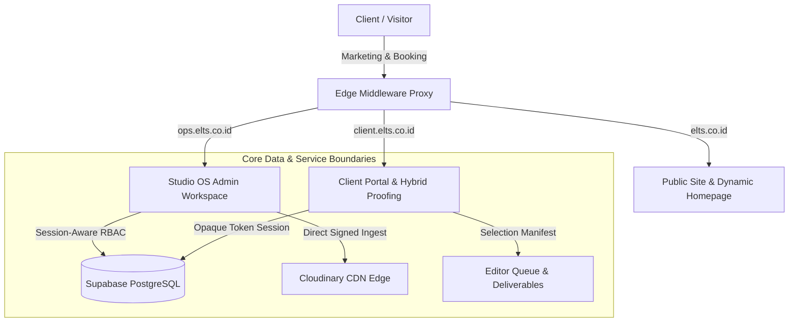
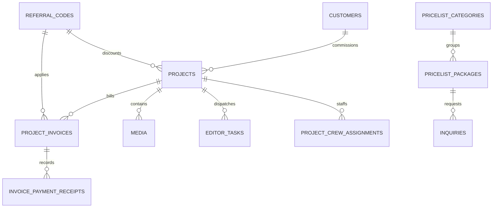

# eLTs Photography Studio OS: Current State & Architecture Report

> **Audited Date:** 2026-10-31  
> **Environment:** macOS (Darwin arm64) | Node.js v26.0.0 | Next.js 16.3.5 (Turbopack) | Supabase Postgres (Remote Hosted)  
> **Repository:** [`/Users/ray/ELT./web/elts`](file:///Users/ray/ELT./web/elts)  
> **Lead Architect / Auditor:** Principal Full-Stack Engineer & System Architect  

---

## Executive Summary

The **eLTs Studio OS** (`elts-photography@2.2.0`) is a multi-tenant, domain-aware operational and commercial platform engineered for modern commercial photography, event coverage, and creative broadcast production. 

Over the recent development cycles culminating in **Migration 0033**, the system has transitioned from a monolithic web prototype into an enterprise-grade operational architecture with strict role-based access controls (RBAC), multi-role hybrid user sessions, cryptographic proofing access, database-enforced financial invariants, and an automated direct-to-CDN media ingestion pipeline.



---

## 1. Codebase & Module Health

### 1.1 Active Framework & Module Matrix

| Tier / Subsystem | Technology Stack | Active Version | Architectural Contract & Role |
| :--- | :--- | :--- | :--- |
| **Application Framework** | Next.js (App Router) | `16.3.5` | Turbopack compilation, React Server Components (RSC), Server Actions (`bodySizeLimit: 50mb`). |
| **Runtime & Language** | React / TypeScript | `19.3.0` / `6.0.3` | React 19 concurrent features, strict mode type safety with `noEmit` verification. |
| **Styling & Design System** | Tailwind CSS / Lucide | `4.3.3` / `1.47.0` | PostCSS v4 engine, design tokens adhering to `#18181b` / `#ff5a00` studio aesthetics. |
| **Database & ORM Layer** | Supabase Postgres / `@supabase/ssr` | `@supabase/supabase-js 2.116.0` | 57 base tables, RLS policies, custom PL/pgSQL RPCs, migration runner. |
| **Authentication & RBAC** | Supabase Auth + Session Context | Custom Session System | Multi-role hybrid structure (`SUPER_ADMIN` [100], `FOUNDER` [90], `ADMIN` [80], `LEAD_EDITOR` [60], `WORKER` [40]). |
| **Media Ingestion & CDN** | Cloudinary SDK / Canvas API | `2.11.0` | Dual-phase: Client-side WebP compression (Canvas) + Direct Signed Cloudinary upload. |
| **Document Generation** | PDF-Lib / QR Code | `1.17.1` / `1.5.4` | Automated commercial invoice generation, payment receipts, and QR authentication. |
| **Edge Routing & Ingress** | Next.js Proxy Middleware | Domain-Aware Rewriter | Subdomain mapping (`ops.elts.co.id`, `client.elts.co.id`, `elts.co.id`) with strict cookie scoping. |

### 1.2 Automated Verification & Quality Gates

Empirical verification executed on **2026-10-31** demonstrates 100% test pass rate across all layers:

- **Unit & Integration Test Suite (`npm test`):**
  - **Results:** **195 / 195 Passing (0 Failed, 0 Skipped)**
  - **Duration:** 132.7 seconds across 32 dedicated test files.
  - **Coverage:** RLS policies, PostgreSQL triggers, dual-consent crew state machine, financial split math, invoice payment auto-sync, hybrid proofing quota enforcement, domain classification, and direct Cloudinary upload signing.
- **Multi-Tenancy Smoke Test Suite (`npm run test:smoke`):**
  - **Results:** **12 / 12 Passing (0 Failed)**
  - **Coverage:** Root domain 301 redirects, marketing route preservation, client portal rewrites, ops security gate with unauthenticated login redirects, and root-domain cookie non-leakage invariant.
- **Static Analysis & Typechecking:**
  - `npm run typecheck` (`tsc --noEmit`): **0 Errors**.
  - `npm run lint` (`eslint .`): **0 Errors, 0 Warnings**.
- **Production Build (`npm run build`):**
  - Compiled cleanly via Turbopack in 13.2 seconds with all static and dynamic routes verified.

---

## 2. Database & Schema Status

### 2.1 Applied Migration Ledger (`public.schema_migrations`)

All 33 repository migrations are synchronized and ledgered in the remote Supabase database:

```sql
0001_consolidated_studio_os.sql           (Applied: 2026-09-28) - Studio OS Core, Projects, Media, Customers
0002_rbac_core.sql                        (Applied: 2026-10-19) - Role & Permission DDL
0003_rbac_policies.sql                    (Applied: 2026-10-19) - Strict Row-Level Security Policies
0004_studio_payment_methods.sql           (Applied: 2026-10-19) - Payment Gateway & Bank Account Presets
0005_gallery_session_rpcs.sql             (Applied: 2026-10-19) - Opaque Session Security for Client Galleries
0006_modernization_core.sql               (Applied: 2026-10-19) - Schema Normalization & Constraint Tightening
0007_rbac_access_repair.sql               (Applied: 2026-10-19) - Admin Escalation Fixes
0008_crew_token_lifecycle.sql             (Applied: 2026-10-19) - Magic Token Dispatch for Crew Consent
0009_inventory_worker_projection.sql      (Applied: 2026-10-19) - Zero-Leakage Inventory Views
0010_inventory_view_service_reader.sql    (Applied: 2026-10-19) - Service Role View Grants
0011_inventory_predicate_execute_grant.sql(Applied: 2026-10-20) - Inventory Conflict RPC Execution
0012_payroll_identity_and_equity.sql      (Applied: 2026-10-20) - Freelancer vs Internal Payout Tables
0013_payroll_core_schema.sql              (Applied: 2026-10-20) - Payroll Cycles & Compensation Line Items
0014_earnings_rpc_and_rls.sql             (Applied: 2026-10-20) - Crew Personal Earnings Visibility
0015_payroll_rpc_explicit_rank.sql        (Applied: 2026-10-20) - Rank-Based Payout Execution
0016_payroll_cycle_lock_and_audit.sql     (Applied: 2026-10-20) - Immutable Audit Logs for Payroll Lock
0017_generate_payroll_cycle_rpc.sql       (Applied: 2026-10-20) - Idempotent Payroll Cycle Generation
0018_payslip_numbering.sql                (Applied: 2026-10-20) - Sequential Document Numbering
0019_multi_role_session_context.sql       (Applied: 2026-10-20) - Hybrid Role Structure (Base Role + Active Role)
0020_session_aware_roles.sql              (Applied: 2026-10-20) - Contextual RLS Evaluators
0021_user_profiles_and_payout.sql         (Applied: 2026-10-20) - Bank Account & Tax ID Profiles
0022_session_listing_rpcs.sql             (Applied: 2026-10-20) - Active Session Roster Inspection
0023_role_management.sql                  (Applied: 2026-10-20) - Super Admin Role Assignment Guards
0024_identity_single_source.sql           (Applied: 2026-10-20) - Unified Identity via auth.users
0025_pricelist.sql                        (Applied: 2026-10-20) - Database-Backed Packages & Addons
0026_portfolio_builder.sql                (Applied: 2026-10-20) - CMS Pages & Canvas Grid Layout Sections
0027_consultation_leads.sql               (Applied: 2026-10-31) - Inquiries, CRM Status, Conversion RPC
0028_portfolio_categories.sql             (Applied: 2026-10-31) - Strict Portfolio Category Enum Alignment
0029_crew_assignment_completion.sql       (Applied: 2026-10-31) - Assignment Resolution Triggers
0030_portfolio_anon_read_fix.sql          (Applied: 2026-10-31) - Public Read RLS for Published Showcase
0031_referral_codes.sql                   (Applied: 2026-10-31) - Marketing Referral Codes & Commissions
0032_allow_draft_to_ready_transition.sql  (Applied: 2026-10-31) - State Machine: Direct Draft -> Ready Transition
0033_project_workspace_refinements.sql    (Applied: 2026-10-31) - Cascading Deletes & Project Referral Columns
```

### 2.2 Core Entity Model & Invariants



1. **`public.projects` (29 columns):**
   - **Lifecycle & Identity:** `status` enum (`draft`, `editing`, `ready`, `archived`, `expired`), `access_token` (UUID-based magic token for PIN-free proofing access), `slug`, `gallery_code`, `gallery_pin_hash`.
   - **Hybrid Proofing Gates:** `selection_quota_min` (e.g. 15), `selection_quota_max` (e.g. 20), `selection_locked_at` (timestamp, prevents post-submit mutation), `selection_deadline` (countdown boundary), `allow_download` (boolean).
   - **Financial Synchronization:** `contract_value`, `dp_amount`, `is_dp_paid`, `is_fully_paid` (triggers commercial gates), `referral_code`, `referral_discount_amount`.
   - **Modular Specs:** `sector_specs` (JSONB storing sector-specific specs: `googleDriveUrl`, shot lists, video deliverable counts).
2. **`public.project_invoices` & `public.invoice_payment_receipts`:**
   - **Invoices (17 cols):** `gross_contract_value`, `minimum_dp_pct`, `line_items` (JSONB array), `referral_discount_amount`.
   - **Receipts (16 cols):** `amount`, `payment_method`, `applied_to` (`DP` | `BALANCE` | `UNALLOCATED`), `verified_at`, `verified_by`.
   - **Automated Financial Triggers:** Logging a verified DP receipt flips `projects.is_dp_paid = true`; logging a settled balance flips `projects.is_fully_paid = true` and unlocks download/Drive gates.
3. **`public.editor_tasks` (13 columns):**
   - **Role:** Automatically populated upon client photo selection submission via `public.submit_photo_selection(project_id, session_id)`.
   - **Manifest Storage:** `deliverable_count` and `manifest_json` (array of selected media IDs, filenames, and client aspect crop parameters).
   - **Payout Binding:** `rate_id`, `payable_amount`, and `assigned_user_id` bind editor remuneration directly into the payroll ledger.
4. **`public.referral_codes` (12 columns):**
   - **Sales Attribution:** `code` (e.g. `RIANSALES10`), `sales_name`, `discount_type` (`fixed` | `percentage`), `discount_value`.
   - **Concurrency & Caps:** `max_uses`, `used_count` (atomic increment), `expiry_date`, `status` (`ACTIVE`, `DISABLED`, `EXPIRED`).

---

## 3. Active Feature Inventory

### 3.1 Project Creation Wizard with Pricelist & Referral Sync
- **Location:** [`src/components/admin/projects/project-create-wizard.tsx`](file:///Users/ray/ELT./web/elts/src/components/admin/projects/project-create-wizard.tsx)
- **Features:**
  - Database-backed package selection pulling real-time rates from `public.pricelist_packages`.
  - Automatic quota derivation via `extractPhotoQuotaFromIncludes` (parses packages like *"50 Edited Photos"* $\to$ sets `selection_quota_min: 50, selection_quota_max: 50`).
  - Automatic specification mapping via `syncPackageToSectorSpecs` (populates shot lists for Photo, video deliverables for Video, tech notes for Broadcast).
  - Client-side and server-side referral code verification applying real-time fixed or percentage discounts.
  - One-click workspace scaffolding executing `draft -> ready` transition via Migration 0032.

### 3.2 Workspace Invoice Generation & Payment Sync
- **Location:** [`src/app/actions/invoices.ts`](file:///Users/ray/ELT./web/elts/src/app/actions/invoices.ts) & [`src/components/admin/workspace/invoice-modal.tsx`](file:///Users/ray/ELT./web/elts/src/components/admin/workspace/invoice-modal.tsx)
- **Features:**
  - Automated dual-invoice generation (DP Invoice & Final Settlement Invoice).
  - Client DTO filtering with zero internal operational leakage (`get_client_invoice_dto` returns client rates with internal margins stripped).
  - Instant PDF generation via `pdf-lib` embedding verification QR codes and official payment bank accounts.
  - Automated payment triggers synchronizing project financial status and logging ledger inflows.

### 3.3 Dynamic Homepage & 12-Hour About Collage Rotation
- **Location:** [`src/app/(marketing)/page.tsx`](file:///Users/ray/ELT./web/elts/src/app/(marketing)/page.tsx) & [`src/lib/homepage/featured-works.ts`](file:///Users/ray/ELT./web/elts/src/lib/homepage/featured-works.ts)
- **Features:**
  - Queries active published portfolio showcases and extracts hero photography in reading order.
  - Deterministic 12-hour rotation offset (`getTwelveHourRotationOffset`) based on Asia/Jakarta wall-clock time, ensuring marketing hero imagery cycles dynamically without client-side hydration mismatch.

### 3.4 Direct Client-to-Cloudinary Resilient Ingest Pipeline
- **Location:** [`src/lib/upload-client.ts`](file:///Users/ray/ELT./web/elts/src/lib/upload-client.ts) & [`src/lib/images/compression.ts`](file:///Users/ray/ELT./web/elts/src/lib/images/compression.ts)
- **Features:**
  - **In-Browser Compression:** Canvas-based raster scaling (max 2048px, 0.85 WebP) reducing 20–30MB camera RAW/JPEGs by 85–95% before transfer.
  - **Direct Signed Upload:** Bypasses Vercel/Next.js 4.5MB serverless payload ceiling (`HTTP 413`) by requesting HMAC-SHA1 signatures from `prepareDirectPortfolioUploadAction` and streaming bytes directly to Cloudinary CDN ingest.
  - **Serverless Headroom:** Fallback `/api/upload` route configured with elevated 50MB file size limit and 60-second execution window.

### 3.5 Token-Based Hybrid Proofing Workflow
- **Location:** [`src/app/(client)/proofing/[token]/page.tsx`](file:///Users/ray/ELT./web/elts/src/app/(client)/proofing/[token]/page.tsx)
- **Features:**
  - **Frictionless Magic Access:** Single-click authentication using UUID project `access_token` creating cryptographic gallery sessions.
  - **Interactive Selection HUD:** Live quota tracker comparing selected count against `selection_quota_min` and `selection_quota_max`.
  - **Urgency Timers:** Countdown indicators bound to `selection_deadline`.
  - **Selection Lock:** Submitting invokes `public.submit_photo_selection()`, instantly locking the gallery and dispatching an editor task with the complete JSON manifest.
  - **Google Drive Gate:** Hi-res master drive URL (`sector_specs.googleDriveUrl`) is strictly gated until `is_fully_paid = true`.

---

## 4. Current Architecture Baseline & Readiness

The repository is currently in an optimal state for feature expansion:

```
[Repository Health Check]
✔ Git Working Tree       : Clean (origin/main: 947bfbb)
✔ Automated Test Suite   : 195/195 tests passing
✔ Subdomain Smoke Tests  : 12/12 passing
✔ TypeScript Compiler    : 0 errors
✔ ESLint Code Quality    : 0 warnings
✔ Production Build       : Optimized build passing (13.2s)
✔ Database Migrations    : 33/33 synchronized with remote Supabase
```

The system provides a reliable baseline for upcoming roadmap items such as advanced client collaboration, automated WhatsApp notification queues, multi-camera live broadcast telemetry, and client-facing invoice portals.
